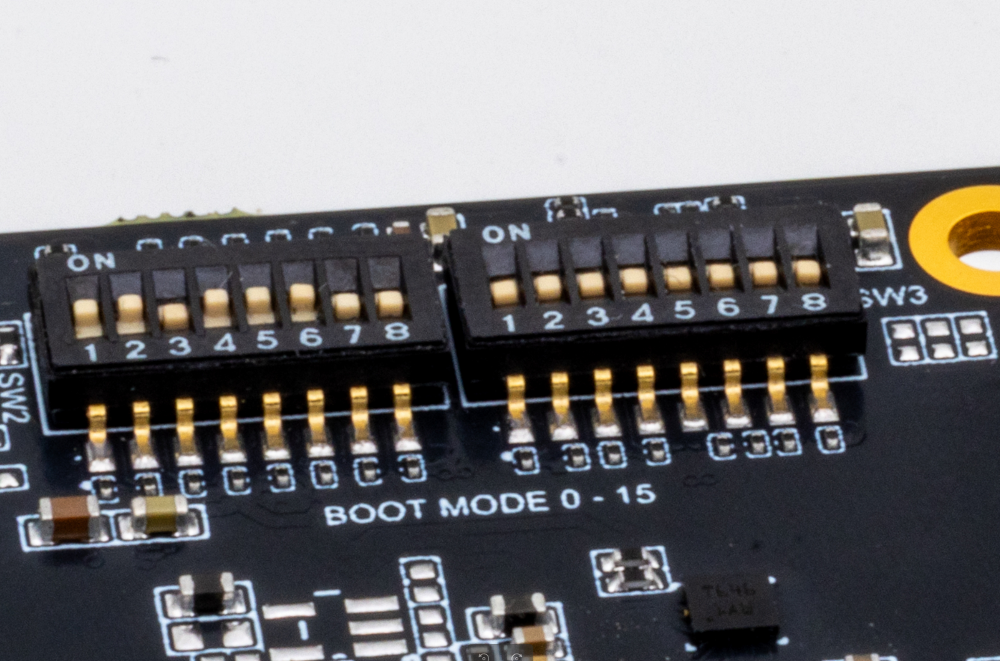
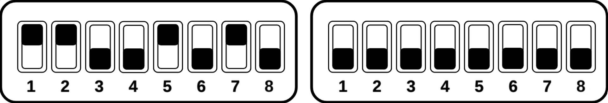
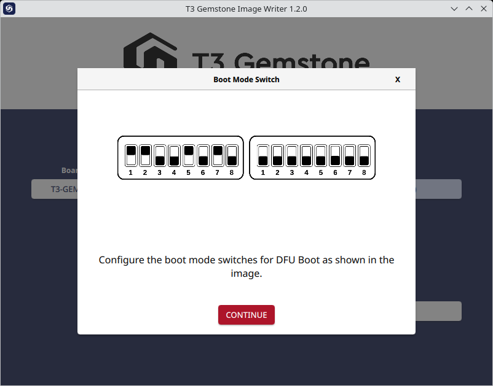
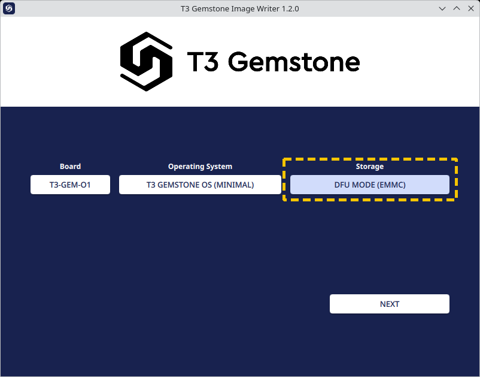
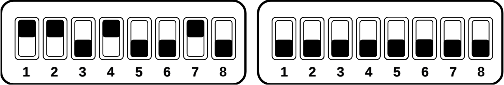
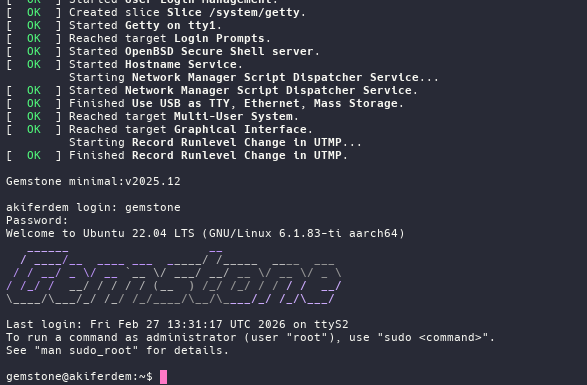

<Tip>
By the end of this section, you will know how to write an image onto eMMC on the Gemstone development board.
</Tip>

The Gemstone operating system supports booting from eMMC in addition to an SD card.
eMMC is a high-performance and reliable storage solution. Because it offers faster data access
and a more robust physical structure compared to an SD card, it is preferred as the primary
option in many applications.

## 1. Writing an Image to eMMC with USB DFU

USB DFU (Device Firmware Upgrade) is the standard that allows the T3 Gemstone O1 to be programmed
directly over USB. An image can be written to eMMC without needing an SD card or a running system.

<Note>
  Official DFU documentation for the TI AM67A processor:
  [USB Device Firmware Upgrade (DFU) — Processor SDK Linux for AM67A](https://software-dl.ti.com/jacinto7/esd/processor-sdk-linux-am67a/10_00_00/exports/docs/linux/Foundational_Components/U-Boot/UG-DFU.html)
</Note>

### 1.1. Switching to USB DFU Mode

<Warning>
  **Fully power off the board before starting the process.**
  Attempting to switch to DFU mode while the board is running may corrupt the eMMC.
</Warning>

<Steps>
  <Step title="Power off the board">
    If the operating system is running, shut it down properly, then disconnect the power from the T3 Gemstone O1.
  </Step>

  <Step title="Set the bootmode switch to the USB DFU position">
    Using the switch position shown in the diagram below as a reference, set the bootmode switch to the USB DFU position.

    <Frame caption="Physical location of the bootmode switch (representative)">
      
    </Frame>

    <Note>
      The image above is included to show the physical location of the bootmode switch on the board and is representative.
      For DFU mode, follow the switch position from the diagram below.
    </Note>

    <Frame caption="USB DFU boot mode switch position">
      
    </Frame>
  </Step>

  <Step title="Connect the USB-C cable to supply power">
    Plug the USB-C cable into the board's DFU port and into your computer, then power it on.
  </Step>

</Steps>

### 1.2. Writing the Image with T3 Gemstone Imager

T3 Gemstone Imager handles the whole write. It sends the bootloader files (`tiboot3.bin`, `tispl.bin`, `u-boot.img`)
to the board over DFU and then switches the board to **USB mass storage (UMS)** mode. In this mode the board's eMMC
shows up on the computer as a disk, and the image is written and verified directly, as on an SD card.

<Note>
  Writing over UMS is much faster than over DFU: a 1 GB minimal image takes about 30 seconds and a 4 GB desktop
  image about 2 minutes. If the bootloader does not support UMS (older images), the image is sent over DFU
  automatically. That is much slower, but the steps are the same.
</Note>

<Steps>
  <Step title="Open T3 Gemstone Imager">
    Download and install the application from [t3gemstone.org/en/software](https://t3gemstone.org/en/software) and
    open it. Under **Board**, click **CHOOSE DEVICE** and select **T3-GEM-O1**.

    <Note>
      You do not need to run the application as administrator; the permissions it needs are requested during the
      write. See **1.3. Permissions by Operating System** below.
    </Note>
  </Step>

  <Step title="Select the operating system image">
    Click **CHOOSE OS** and select the image you want to write. The images in the list are downloaded from the
    internet; you can also select an `.img` or `.img.xz` file on your computer.
  </Step>

  <Step title="Select DFU mode as the target">
    Click **CHOOSE STORAGE** and select **DFU Mode (eMMC)**. The **Boot Mode Switch** window that opens shows the
    switch position for DFU mode. Check that the board's switches are in this position and click **CONTINUE**.

    <Frame>
      
    </Frame>

    <Frame>
      
    </Frame>
  </Step>

  <Step title="Write the image">
    Click **Next** to configure the OS customization options (see the [Customization](/en/imager/customization)
    page), then start the write.

    During the write the application shows these steps in order:

    1. **Fetching bootloader files...**: The bootloader is taken from the image itself if the image is on your
       computer, otherwise from the server, and its checksum (SHA-256) is checked.
    2. **Sending bootloader / tispl.bin / u-boot.img...**: The bootloader stages are sent to the board over DFU.
    3. **Switching the board to USB mass storage mode...**: The board exposes its eMMC as a disk.
    4. **Writing image to the board over USB mass storage...**: The image is written and then verified.
    5. **Device is writing to eMMC (do not power off)...**: The board writes its last cached data to the eMMC.

    <Warning>
      Do not unplug the USB cable or remove power during the write. Do not eject or format the disk that appears
      on your computer during the write; the application ejects it itself when the write is done.
    </Warning>
  </Step>

  <Step title="Wait for completion">
    When the write is done, the application shows **Image written to eMMC successfully!**
  </Step>

  <Step title="Power off the board and set the bootmode switch to eMMC">
    Remove power from the board, then set the bootmode switch to the **eMMC** position as shown below.

    <Frame caption="eMMC boot mode switch position">
      
    </Frame>

    <Note>
      You can follow the boot over UART with a serial port connection.
      Default baud rate: **115200**
    </Note>

    After power is applied, the board boots from the image on the eMMC.

    <Frame caption="Serial port output during the DFU transfer">
      
    </Frame>

    For more information on the UART connection, see the [Serial Port](/en/boards/o1/peripherals/serial) page.
  </Step>
</Steps>

### 1.3. Permissions by Operating System

<Tabs>
  <Tab title="Windows">
    - Windows asks for administrator approval (UAC) when the application starts.
    - The installer also installs the **WinUSB** driver the board's DFU interface needs. You do not need to install a
      driver with [Zadig](https://zadig.akeo.ie/).
    - If you cleared **DFU driver (USB flashing)** during installation, the application reports that it cannot reach
      the board. Run the installer again and leave that option selected; the board does not need to be power cycled.
  </Tab>
  <Tab title="Linux">
    - On the first DFU write, your administrator password is asked once to install the udev rule that gives access
      to the board's DFU interface.
      If it is not entered, the application reports *"Authentication failed or was cancelled"*.
    - Your administrator password may be asked for disk access when the image is written over UMS.
  </Tab>
  <Tab title="macOS">
    - Open the **.dmg** and drag **T3 Gemstone Imager** to the **Applications** folder.
    - On Apple silicon (M series) Macs, macOS asks *"Allow accessory to connect?"* the first time the board is
      plugged in. Choose **Allow**; otherwise the application cannot find the board in DFU mode. If you missed the
      prompt, unplug the USB cable and plug it in again.
    - When the board switches to UMS mode, macOS asks for your administrator password to write to the disk.
    - During the write the board's disk is not mounted in Finder and no "disk not readable" prompt appears; the
      application ejects the disk itself when the write is done.
  </Tab>
</Tabs>

### 1.4. Possible Errors

| Message | What to do |
|---------|------------|
| Failed to download bootloader file | Check your internet connection and retry. This error is also shown when the checksum of the downloaded file does not match. |
| The board switched to USB mass storage mode, but no disk appeared ... | Power off the board, set the bootmode switch to DFU again, restore power and retry. |
| DFU transfer failed while sending ... | Power off the board, set the bootmode switch to DFU again, restore power and retry. |
| The device is still writing to eMMC ... minutes after the transfer finished | Do **not** power off the board; follow the serial console and wait until the write finishes. |

The application writes a log file for every session. Attaching it when you report a problem in the
[gem-imager](https://github.com/t3gemstone/gem-imager/issues) repository helps solve it faster.

## 2. Manual Image Loading with the SDK (dfu-util)

<Warning>
  This method is for developers working with the SDK build system.
</Warning>

<Note>
  For more information about building an image from source, see the [SDK documentation](/en/sdk/introduction).
</Note>

Put the board into DFU mode using the bootmode switch as described in
[1.1. Switching to USB DFU Mode](#1-1-switching-to-usb-dfu-mode), then run the following commands in order.

After a successful SDK build, the required files are located in two directories:

| File | Location |
|-------|-------|
| `tiboot3.bin` | `build/t3-gem-o1/deploy-ti/images/t3-gem-o1/` |
| `tispl.bin` | `build/t3-gem-o1/deploy-ti/images/t3-gem-o1/` |
| `u-boot.img` | `build/t3-gem-o1/deploy-ti/images/t3-gem-o1/` |
| `gemstone-*.img` | `build/debos/` |

<Steps>
  <Step title="Load the first-stage bootloader (tiboot3.bin)">
    ```bash
    sudo dfu-util -d 0451:6165 -a bootloader -D tiboot3.bin -R
    ```

    After this step, the board will reset and reconnect. Wait a few seconds and verify that the
    board is still visible with `dfu-util -l`.
  </Step>

  <Step title="Load the TI SPL (tispl.bin)">
    ```bash
    sudo dfu-util -d 0451:6165 -a tispl.bin -D tispl.bin -R
    ```
  </Step>

  <Step title="Load U-Boot (u-boot.img)">
    ```bash
    sudo dfu-util -d 0451:6165 -a u-boot.img -D u-boot.img -R
    ```
  </Step>

  <Step title="Transfer the OS image to eMMC">
    Replace `<image-file-name>` with the name of your own image file:

    ```bash
    sudo dfu-util -d 0451:6165 -a rawemmc \
        -D <image-file-name>.img -R
    ```

    <Warning>
      This step transfers the entire OS image to the eMMC over USB. Do not interrupt the transfer.
      Depending on the image size and USB speed, this process may take several minutes.
    </Warning>
  </Step>

  <Step title="Power off the board and set the bootmode switch to the eMMC position">
    When `dfu-util` reports success, fully power off the board, then set the bootmode switch to the
    **eMMC** position.

    <Frame caption="eMMC boot mode switch position">
      
    </Frame>

    <Note>
      You can monitor the boot process via a serial port connection over UART.
      Default baudrate: **115200**
    </Note>

    After applying power, the board will boot from the image on the eMMC.
  </Step>
</Steps>

### 2.1. Verification Step

Before running the commands, verify that the board appears as a DFU device.

<Step title="Verify the DFU device">
  Verify that the board appears as a DFU device.

  <Tabs>
    <Tab title="Linux">
      If the application named `dfu-util` is not installed, install it on your Ubuntu computer with the `sudo apt install dfu-util` command.

      ```bash
      sudo dfu-util -l
      ```
    </Tab>
    <Tab title="Windows">
      Download the `dfu-util` Windows binary from the Releases section of the
      [dfu-util homepage](https://dfu-util.sourceforge.net/) and extract the zip, then run it:

      ```powershell
      dfu-util.exe -l
      ```

      <Note>
        If the output of `dfu-util.exe -l` is empty on Windows, the **WinUSB** driver is not installed. The
        T3 Gemstone Imager installer installs it; if you have not installed the Imager, you can install the driver
        with [Zadig](https://zadig.akeo.ie/):

        1. Download and run Zadig from [zadig.akeo.ie](https://zadig.akeo.ie/)
            (no installation required; it will request UAC administrator approval)
        2. If the board does not appear in the list, enable the **Options → List All Devices** option
        3. From the drop-down list, select the device with VID `0451` / PID `6165`
        4. Select **WinUSB** as the driver and click the **Install Driver** button
        5. When the installation is complete, the driver name will be displayed in green
      </Note>
    </Tab>
  </Tabs>

  You should see an entry with VID:PID **0451:6165** containing the `bootloader` and `SocId`
  alt settings.

  ```
  Found DFU: [0451:6165] ver=0200, devnum=9, cfg=1, intf=0, path="1-2.2", alt=1, name="SocId", serial="01.00.00.00"
  Found DFU: [0451:6165] ver=0200, devnum=9, cfg=1, intf=0, path="1-2.2", alt=0, name="bootloader", serial="01.00.00.00"
  ```

  If the device does not appear in the list, try again starting from step 1.
</Step>
