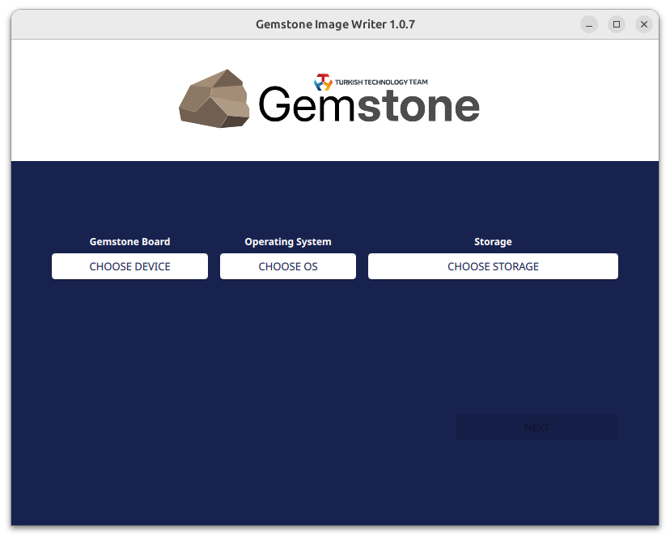

The T3 Gemstone Imager application has been developed to easily handle the selection, downloading, customization,
and writing of Gemstone images to an SD card or the onboard storage device on supported boards—all from a single place.
It works on Linux, Windows, and macOS and is user-friendly.

You can download the application from [t3gemstone.org/en/software](https://t3gemstone.org/en/software):

| Operating system | Package |
|------------------|---------|
| Linux | `.AppImage` |
| Windows | `.exe` installer (also installs the board's DFU driver) |
| macOS | `.dmg` (Apple silicon and Intel) |

To write to the eMMC of a T3-GEM-O1 while the board is connected to your computer over USB-C, see the
[Using eMMC](/en/imager/emmc) page.

<Frame>  
    
</Frame>
