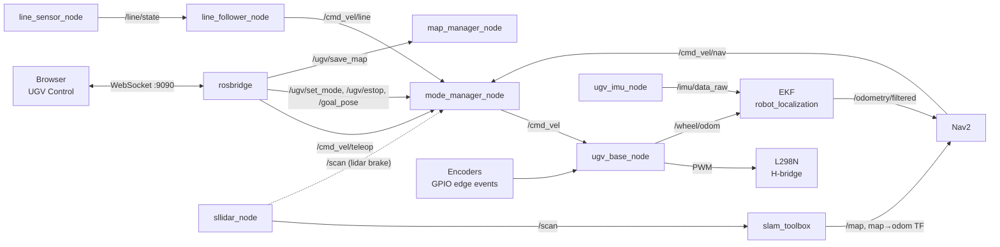
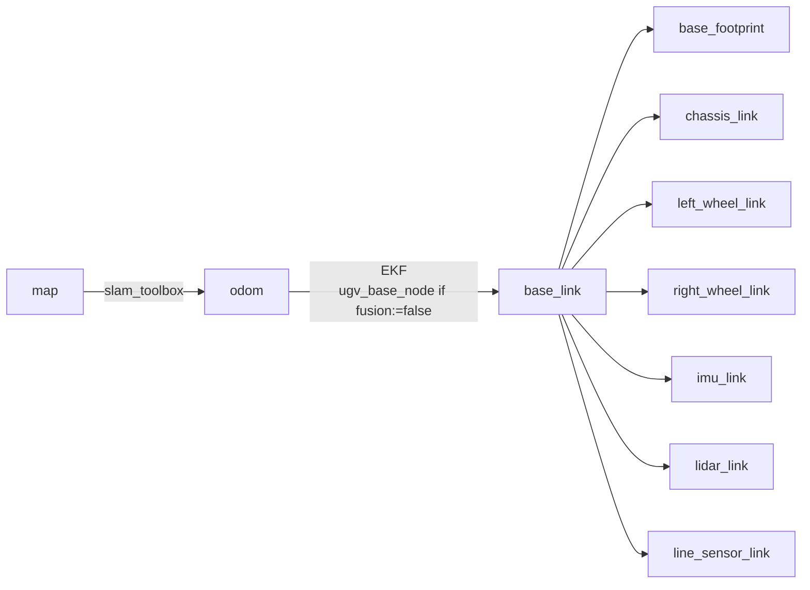

## 1. Packages

| Package | Type | Role |
| --- | --- | --- |
| `ugv_interfaces` | msg/srv | `LineState`, `LidarStatus`, `SetMode`, `SaveMap`, `SetLidar` |
| `ugv_description` | URDF | Robot model; `config/robot.yaml` is the single source of geometry |
| `ugv_hal` | Python library | GPIO (libgpiod v1/v2, resolution by line name), sysfs PWM (by module name), `mock`; `lidar_manager_node` (USB / GPIO lidar selection) |
| `ugv_base` | Python | Wheel speed control with encoder feedback, wheel odometry, `hw_check` |
| `ugv_imu` | C++ | ICM-20948 SPI driver, gyroscope bias calibration |
| `ugv_line` | Python | 8-channel sensor array (Deneyap Kart ADC → UART, digital threshold or QTR-8RC RC timing), PD line following, `line_check` |
| `ugv_control` | Python | Mode manager: command multiplexer, emergency stop, lidar brake |
| `ugv_navigation` | config + Python | slam_toolbox, Nav2, map saving service |
| `ugv_gcs` | web + Python | Browser interface, rosbridge, robot pose publisher |
| `ugv_bringup` | launch + config | Single launch file; all pins in the `config/hardware.yaml` file |

Hardware-independent logic (kinematics, PID, encoder decoding, line position, multiplexer, brake) lives in ROS-free
modules and is tested with `pytest`.

## 2. Data Flow

`mode_manager_node` forwards to the `/cmd_vel` topic only the velocity command coming from the source that matches the
active mode; the emergency stop and the lidar brake are also applied in this node.

## 3. Driving Modes

| Mode | Command reaching the motors | How it is entered |
| --- | --- | --- |
| `idle` | None | Startup, after an emergency stop, interface |
| `manual` | `/cmd_vel/teleop` | Interface, or a non-zero teleop command in any mode |
| `line` | `/cmd_vel/line` | Interface |
| `nav` | `/cmd_vel/nav` | Clicking on the map in the interface, or `/goal_pose` |

- The emergency stop takes precedence over all modes and switches the mode to `idle`.
- When leaving `nav` mode, Nav2 goals are canceled.
- The lidar brake (**enabled** by default, `control.yaml` → `safety.enabled`) limits the
  forward/backward speed in every mode. Obstacles are only searched for in the corridor the robot is about to travel
  (body width + margin), and the distance is measured from the front/rear end of the body. A wall at the side does not
  block driving, and turning is never restricted (`control.yaml` → `safety`, body dimensions in `robot.yaml`).

### 3.1. Direction convention

All `/cmd_vel*` commands and kinematics follow REP-103: `linear.x > 0` is forward, and `angular.z > 0` is a
counterclockwise (left) turn viewed from above.

<Note>
**The only exception is the web interface key mapping.** When reversing, the left/right keys behave like a car's
steering wheel; the left key moves the rear of the vehicle to the left (`angular.z < 0`). This translation is done only
in the browser (`app.js` → `steering`); the command sent to the robot still follows REP-103. Line following and Nav2
do not go through this translation.
</Note>

## 4. TF Tree

The transforms below `base_link` are published by `robot_state_publisher`.

## 5. Topics and Services

| Name | Type | Publisher / Server |
| --- | --- | --- |
| `/cmd_vel` | `geometry_msgs/Twist` | mode_manager_node |
| `/wheel/odom` | `nav_msgs/Odometry` | ugv_base_node |
| `/ugv_base_node/wheels` | `std_msgs/Float32MultiArray` | ugv_base_node (for PID tuning) |
| `/imu/data_raw` | `sensor_msgs/Imu` | ugv_imu_node |
| `/odometry/filtered` | `nav_msgs/Odometry` | ekf_filter_node |
| `/scan` | `sensor_msgs/LaserScan` | sllidar_node (started by lidar_manager_node) |
| `/ugv/lidar` | `ugv_interfaces/LidarStatus` (latched) | lidar_manager_node |
| `/line/state` | `ugv_interfaces/LineState` | line_sensor_node |
| `/line_follower/status` | `std_msgs/String` | line_follower_node |
| `/ugv/mode` | `std_msgs/String` (latched) | mode_manager_node |
| `/ugv/estop_active` | `std_msgs/Bool` (latched) | mode_manager_node |
| `/ugv/obstacle_distance` | `std_msgs/Float32` | mode_manager_node |
| `/ugv/robot_pose` | `geometry_msgs/PoseStamped` | robot_pose_node |
| `/ugv/set_mode` | `ugv_interfaces/SetMode` | mode_manager_node |
| `/ugv/estop` | `std_srvs/SetBool` | mode_manager_node |
| `/ugv/save_map` | `ugv_interfaces/SaveMap` | map_manager_node |
| `/ugv/reset_map` | `std_srvs/Trigger` | map_manager_node (EKF pose and, in mapping mode, the SLAM map) |
| `/ugv/set_lidar` | `ugv_interfaces/SetLidar` | lidar_manager_node |
| `/line/calibrate_white` | `std_srvs/Trigger` | line_sensor_node |
| `/line/calibrate_black` | `std_srvs/Trigger` | line_sensor_node |
| `/line/calibration_status` | `std_msgs/String` (JSON) | line_sensor_node |

## 6. Configuration Files

| File | Contents |
| --- | --- |
| [`ugv_bringup/config/hardware.yaml`](https://github.com/t3gemstone/ugv-ros/blob/main/src/ugv_bringup/config/hardware.yaml) | Pins, PWM channels, motor/encoder settings, PID, line sensor and lidar connection |
| [`ugv_bringup/config/control.yaml`](https://github.com/t3gemstone/ugv-ros/blob/main/src/ugv_bringup/config/control.yaml) | Mode manager and lidar brake (`safety`), line following gains, map manager |
| [`ugv_bringup/config/ekf.yaml`](https://github.com/t3gemstone/ugv-ros/blob/main/src/ugv_bringup/config/ekf.yaml) | robot_localization EKF settings |
| [`ugv_description/config/robot.yaml`](https://github.com/t3gemstone/ugv-ros/blob/main/src/ugv_description/config/robot.yaml) | Wheel radius, wheel separation, body dimensions, IMU and lidar placement |
| [`ugv_navigation/config/slam.yaml`](https://github.com/t3gemstone/ugv-ros/blob/main/src/ugv_navigation/config/slam.yaml) | slam_toolbox settings |
| [`ugv_navigation/config/nav2.yaml`](https://github.com/t3gemstone/ugv-ros/blob/main/src/ugv_navigation/config/nav2.yaml) | Nav2 settings |
