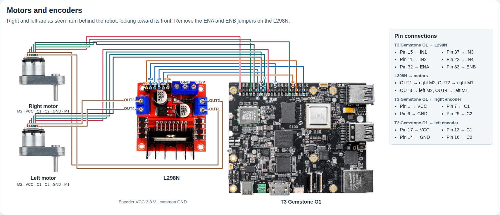
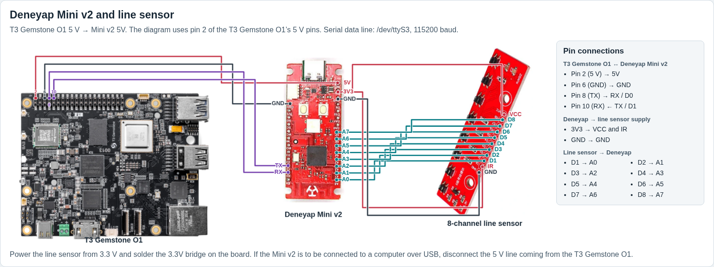
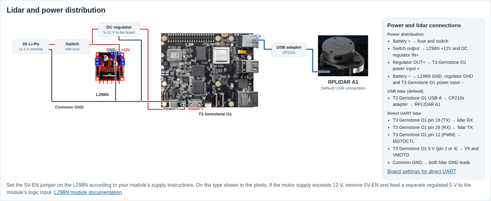
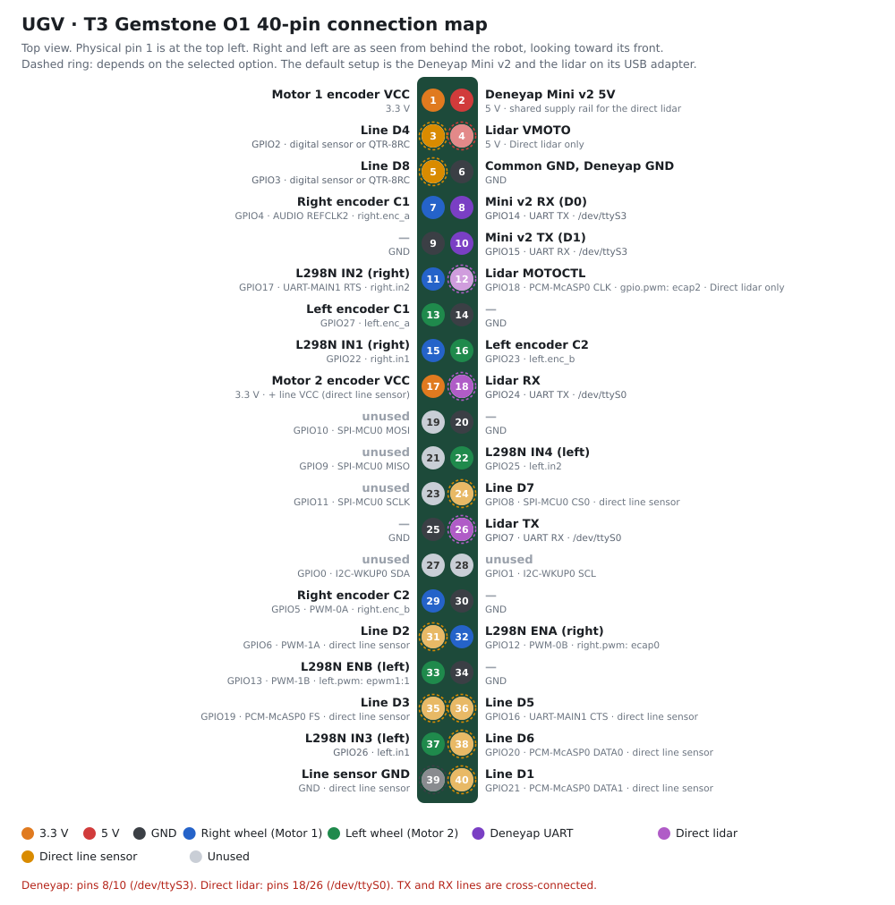

All hardware connections of the robot are defined in a single file in the software:
[`src/ugv_bringup/config/hardware.yaml`](https://github.com/t3gemstone/ugv-ros/blob/main/src/ugv_bringup/config/hardware.yaml).
Pins are written with T3 Gemstone O1 line names (`"GPIO22"`) and PWM channels with module names (`"ecap0"`); the software
resolves them to the board's lines by itself.

<Warning>
Always disconnect the battery and all power sources before changing wires. Changing pins while the battery is
connected can damage the GPIOs. Read the [Battery and Operating Safety](/en/projects/ugv-ros/safety) page before you
start wiring.
</Warning>

## 1. Components

| Component | Connection | Software package |
| --- | --- | --- |
| T3 Gemstone O1 | — | Ubuntu 24.04 + ROS 2 Jazzy |
| L298N + 2 × Waveshare DCGM-3865 (12 V, 1:42, 240 rpm) | IN1–IN4 (GPIO), ENA/ENB (PWM) | `ugv_base` |
| Motor encoders (hall, AB, 546 PPR at the output shaft, internal pull-up) | 4 × GPIO | `ugv_base` |
| ICM-20948 IMU | Onboard, SPI `/dev/spidev0.3` | `ugv_imu` |
| RPLIDAR A1 | USB adapter (default) **or** UART `/dev/ttyS0` (pins 18/26) + motor PWM | `sllidar_ros2`, `ugv_hal` |
| Pololu QTR-8A 8-channel line sensor (analog output) | Deneyap Mini v2 ADC → UART `/dev/ttyS3` (default) **or** 8 × GPIO | `ugv_line` |
| 3S Li-Po (11.1 V, 4200 mAh, 40C) | L298N supply; regulated DC supply to the T3 Gemstone O1 power input. All GND terminals are common. | — |

## 2. Wiring Diagram

The signal connections reflect the `hardware.yaml` configuration. The complete wiring diagram is also available as a
[PDF](/images/ugv-ros/ugv-wiring.pdf).

### 2.1. Motors and encoders

<Frame>
  
</Frame>

### 2.2. Deneyap Mini v2 and line sensor

<Frame>
  
</Frame>

### 2.3. Lidar and power distribution

<Frame>
  
</Frame>

## 3. 40-Pin Header

The pin numbers in the table are the physical numbers on the board.

<Frame caption="T3 Gemstone O1 40-pin connection map for UGV">
  
</Frame>

**Left/right** are defined looking from the back of the robot toward the front, where the line sensor is. Motor 1 in
the diagram (L298N OUT1/OUT2) is the robot's **right** wheel and Motor 2 (OUT3/OUT4) is the **left** wheel; the
`left` / `right` blocks in `hardware.yaml` follow this. If the motors are mounted on the other sides, swap the `left`
and `right` blocks (together with their direction settings) instead of the wires. To verify this,
`hw_check motors` spins the `left` wheel first during the
[Field Test](/en/projects/ugv-ros/field-test#3-motor-directions).

| Pin | Signal | Connection | `hardware.yaml` |
| --- | --- | --- | --- |
| 1 | 3V3 | Motor 1 encoder VCC | — |
| 2, 4 | 5V | Deneyap Mini v2 5V (pin 2 in the diagram). For the GPIO lidar, V5 and VMOTO use the same 5 V line. | — |
| 3 | GPIO2 | Line D4 (only `type: digital`, with the i2c1 overlay disabled) | `pins[3]` |
| 5 | GPIO3 | Line D8 (only `type: digital`, with the i2c1 overlay disabled) | `pins[7]` |
| 6 | GND | Common GND, Deneyap GND | — |
| 7 | GPIO4 | Motor 1 (right wheel) encoder C1 | `right.enc_a` |
| 8 | GPIO14 (UART-MAIN1 TX) | Deneyap RX | `line_sensor_node.serial.port` |
| 9 | GND | Motor 1 encoder GND | — |
| 10 | GPIO15 (UART-MAIN1 RX) | Deneyap TX | `line_sensor_node.serial.port` |
| 11 | GPIO17 | L298N IN2 (right wheel) | `right.in2` |
| 12 | GPIO18 (ecap2) | Lidar MOTOCTL (GPIO lidar only) | `lidar_manager_node.gpio.pwm: ecap2` |
| 13 | GPIO27 | Motor 2 (left wheel) encoder C1 | `left.enc_a` |
| 14 | GND | Motor 2 encoder GND | — |
| 15 | GPIO22 | L298N IN1 (right wheel) | `right.in1` |
| 16 | GPIO23 | Motor 2 (left wheel) encoder C2 | `left.enc_b` |
| 17 | 3V3 | Motor 2 encoder VCC, line sensor VCC (only `type: digital`) | — |
| 18 | GPIO24 (UART-WKUP0 TX) | Lidar RX (GPIO lidar only) | `lidar_manager_node.gpio.port` |
| 22 | GPIO25 | L298N IN4 (left wheel) | `left.in2` |
| 24 | GPIO8 | Line D7 (only `type: digital`) | `pins[6]` |
| 26 | GPIO7 (UART-WKUP0 RX) | Lidar TX (GPIO lidar only) | `lidar_manager_node.gpio.port` |
| 29 | GPIO5 | Motor 1 (right wheel) encoder C2 | `right.enc_b` |
| 31 | GPIO6 | Line D2 (only `type: digital`) | `pins[1]` |
| 32 | GPIO12 (ecap0) | L298N ENA (right wheel) | `right.pwm: ecap0` |
| 33 | GPIO13 (epwm1 B) | L298N ENB (left wheel) | `left.pwm: epwm1:1` |
| 35 | GPIO19 | Line D3 (only `type: digital`) | `pins[2]` |
| 36 | GPIO16 | Line D5 (only `type: digital`) | `pins[4]` |
| 37 | GPIO26 | L298N IN3 (left wheel) | `left.in1` |
| 38 | GPIO20 | Line D6 (only `type: digital`) | `pins[5]` |
| 39 | GND | Line sensor GND (only `type: digital`) | — |
| 40 | GPIO21 | Line D1 (only `type: digital`) | `line_sensor_node.pins[0]` |

## 4. Lidar Connection

The RPLIDAR A1 can be connected in two ways. The connection type is selected from the **Lidar** panel in the web
interface, and the selection is stored on the robot (`~/.ugv/lidar_source`). The default connection is USB.

<Tabs>
  <Tab title="USB (default)">
    Plug the lidar into T3 Gemstone O1's USB port with its own adapter board; no other wiring is needed. The port is found
    automatically under `/dev/serial/by-id/`, and the adapter drives the lidar motor.

    The CP210x USB-serial driver may be missing from the minimal T3 Gemstone O1 image. If `lsusb` shows the adapter but
    `/dev/ttyUSB0` is not created, follow the driver installation steps on the
    [Installation](/en/projects/ugv-ros/installation#2-4-install-the-usb-lidar-driver-cp210x) page.
  </Tab>
  <Tab title="GPIO (UART)">
    Without the adapter, the lidar's 7-pin cable is connected directly to the second UART (UART-WKUP0, `/dev/ttyS0`)
    on the 40-pin header. The UART on pins 8/10 is used by the Deneyap Mini v2.

    | Lidar | T3 Gemstone O1 |
    | --- | --- |
    | V5, VMOTO | T3 Gemstone O1 5 V line (pins 2 and 4). If you share the supply line with the Mini v2, use a suitable distribution connection. |
    | GND (both) | Any GND pin |
    | TX | Pin 26 (GPIO7, UART-WKUP0 RX) |
    | RX | Pin 18 (GPIO24, UART-WKUP0 TX) |
    | MOTOCTL | Pin 12 (GPIO18, `ecap2` PWM) |

    This connection requires the `ugv-bt-off`, `uart-ttys0` and `ecap2` overlays to be enabled and `spidev0-1cs` to be
    selected instead of `spidev0-2cs`. For details, refer to the **GPIO lidar** tab on the
    [Installation](/en/projects/ugv-ros/installation#4-pwm-and-uart-settings-overlay) page. The lidar motor's PWM
    signal is only driven while the GPIO connection is selected.

    <Tip>
    Bridging pins 18 and 26 with a jumper and reading back the data written to `/dev/ttyS0` (loopback test) verifies
    that the UART path is working.
    </Tip>
  </Tab>
</Tabs>

## 5. Line Sensor

The sensor in the kit is the **Pololu QTR-8A**, an 8-channel reflectance sensor array. Each channel is a
phototransistor pulled up to VCC: as reflection increases the output voltage drops, and over a black line the output
is approximately VCC. The board has no comparator; the outputs are analog. The sensor must be **3–6 mm** above the
surface.

<Warning>
**Never power the sensor with 5 V**, and **solder the "3.3V" pad** on the board. With the bridge open, the LEDs glow
very dimly at 3.3 V.
</Warning>

<Note>
The sensor height directly affects the readings. At a height of 1 cm, 2.7–3.0 V was measured on a white surface and
3.1 V on black; at this height the difference drops to 100 mV, and with the direct GPIO connection every channel
reads 1. Lower the sensor to 3–6 mm above the surface.
</Note>

The sensor can be connected in two ways; the connection type is selected with `hardware.yaml` →
`line_sensor_node.type`.

<Tabs>
  <Tab title="Deneyap Mini v2 (default)">
    With the `type: serial` configuration, the Mini v2 reads the eight analog channels in millivolts and sends about 50
    readings per second to T3 Gemstone O1's `/dev/ttyS3` UART at 115200 baud. The UART lines of both boards use 3.3 V logic
    levels.

    **Sensor → Mini v2**

    | Sensor | Mini v2 |
    | --- | --- |
    | D1 | A0 |
    | D2 | A1 |
    | D3 | A2 |
    | D4 | A3 |
    | D5 | A4 |
    | D6 | A5 |
    | D7 | A6 |
    | D8 | A7 |
    | VCC and IR | 3V3 |
    | GND | GND |

    **Mini v2 → T3 Gemstone O1**

    | Mini v2 | T3 Gemstone O1 |
    | --- | --- |
    | TX / D1 (GPIO43) | Pin 10 (GPIO15, UART RX) |
    | RX / D0 (GPIO44) | Pin 8 (GPIO14, UART TX) |
    | GND | Pin 6 (GND) |
    | 5V | T3 Gemstone O1 5 V (pin 2 in the diagram) |

    - The sensor's **D1–D8** outputs go to the Mini v2's **A0–A7** inputs. Here the Mini v2's D1 pin is not a sensor
      input but the UART TX pin going to T3 Gemstone O1.
    - Cross TX and RX on the signal connection and connect the GND terminals together.
    - The Mini v2's 5V pin is connected to the USB supply line. Before connecting the Mini v2 to a computer over USB for
      programming, disconnect the 5 V line coming from T3 Gemstone O1.
      [Deneyap Mini v2 pin definitions](https://docs.deneyapkart.org/tr/Cards/Deneyap-Mini-v2/Pin-Definitions-dymv2)

    On T3 Gemstone O1, `hardware.yaml` must contain `type: serial`, `serial.port: /dev/ttyS3` and
    `serial.baudrate: 115200`. For the firmware to upload to the Mini v2, refer to the
    [Installation](/en/projects/ugv-ros/installation#3-uploading-the-deneyap-mini-v2-firmware) page. The same source
    code can also be compiled for the Deneyap Kart 1A v2; in that case, follow that board's pin labels.
  </Tab>
  <Tab title="Direct GPIO">
    With the `type: digital` configuration, the sensor outputs are thresholded by T3 Gemstone O1 GPIOs without the Deneyap
    (black = 1). On a white surface the output must drop below 0.8 V; this is only possible when the sensor is close to
    the surface and the LEDs are bright.

    | Sensor | T3 Gemstone O1 |
    | --- | --- |
    | VCC | Pin 17 (**3.3 V**) |
    | GND | Pin 39 |
    | IR | Unconnected (LEDs on) |
    | D1 … D8 | Pins 40, 31, 35, 3, 36, 38, 24, 5 |

    - If 5 V is applied, the outputs are pulled up to VCC and will damage T3 Gemstone O1's pins.
    - When the D1–D8 wires are not connected, the inputs float and may read 1; the internal pull-up/pull-down on
      T3 Gemstone O1 pads cannot be enabled from software. If all channels read 1 constantly, first check the VCC/GND and D
      wires.
    - GPIO2/GPIO3 (pins 3/5) used for D4/D8 are the I2C1 lines. If you use this connection, remove the `i2c1-400000`
      overlay from `/boot/uEnv.txt` (no device is connected to I2C1 on the robot). GPIO8 (pin 24) used for D7 is an
      SPI0 chip-select pin; the IMU uses a separate chip-select line inside the board.
    - Pins 12, 18 and 26 are reserved for the GPIO lidar and pin 37 for L298N IN3; they are not assigned to the line
      sensor.
  </Tab>
</Tabs>

The sensor is calibrated from the web interface while the robot is running.
[Line sensor calibration](/en/projects/ugv-ros/usage#3-line-sensor-calibration)

## 6. Electrical Warnings

- **T3 Gemstone O1 GPIOs are 3.3 V.** The encoders are powered from 3V3 in the diagram, so their internal pull-ups also pull
  to 3.3 V. Do not power the encoders from 5 V.
- **Power the line sensor with 3.3 V only** and solder the "3.3V" bridge. The IR pin can be left unconnected.
- The lidar is powered with 5 V, but its UART signals are 3.3 V and can be connected directly. Lidar TX → T3 Gemstone O1 RX
  (pin 26), lidar RX → T3 Gemstone O1 TX (pin 18).
- The ENA/ENB jumpers on the L298N must be **removed**.
- Set the 5V-EN bridge on the L298N according to the module's power supply instructions. If the motor supply exceeds
  12 V, the 5V-EN bridge must be removed and a separate 5 V must be supplied to the module's logic input.
- A fully charged 3S battery is 12.6 V; since the L298N drops about 2 V, the motors run slightly below their rated
  voltage. Measure `max_wheel_speed` with `hw_check sweep` during the
  [Field Test](/en/projects/ugv-ros/field-test#5-speed-range).
- The battery, L298N, T3 Gemstone O1 and encoder GNDs must be common.
- Supply T3 Gemstone O1's power input within its 5–12 V range. Since a fully charged 3S battery
  reaches 12.6 V, feed the power input through a suitable DC regulator.
  [Battery and Operating Safety](/en/projects/ugv-ros/safety)
