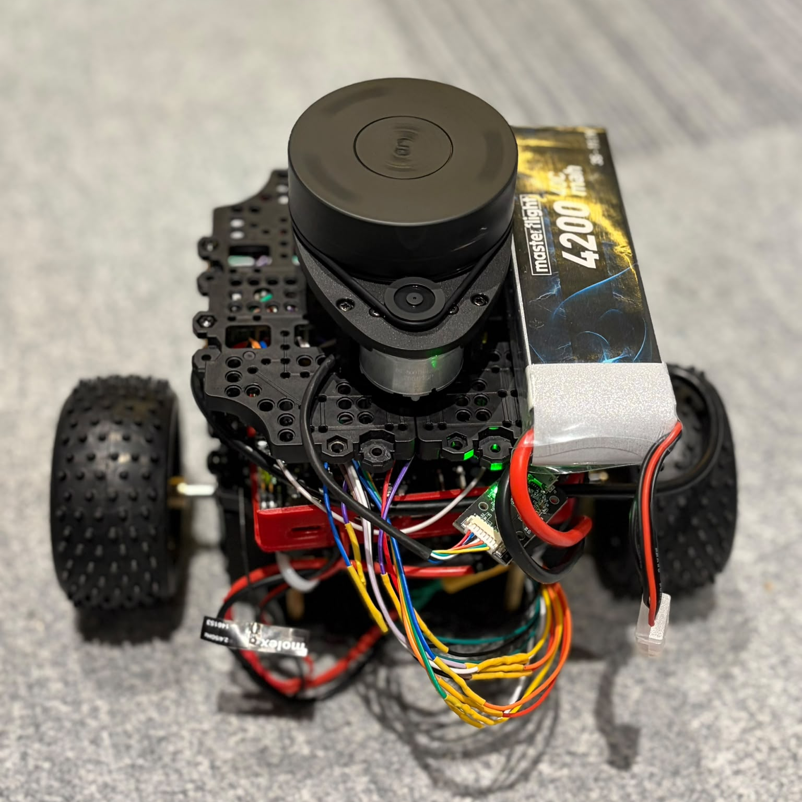
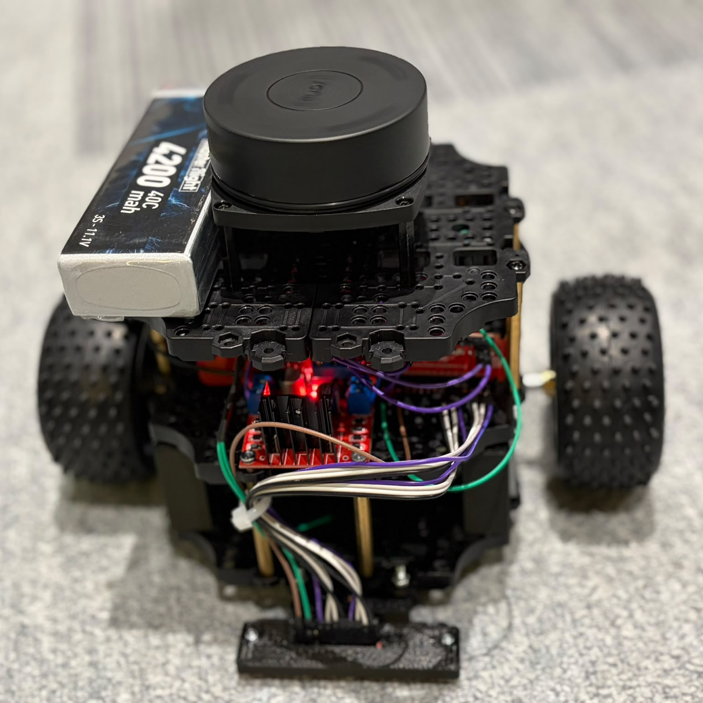
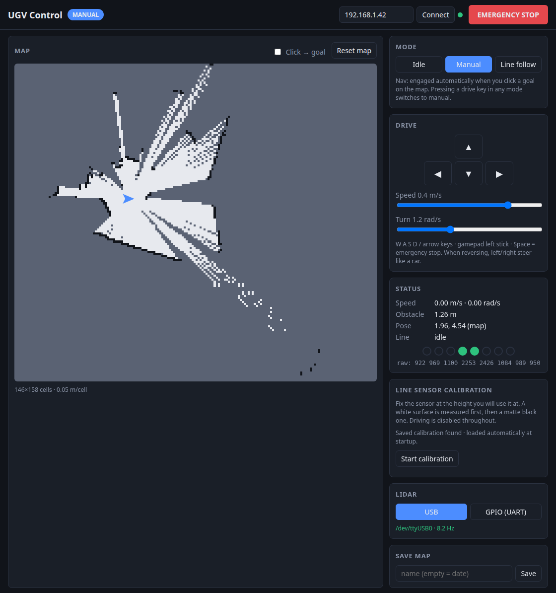

<Columns cols={2}>
  <Frame caption="Battery and cable layout">
    
  </Frame>
  <Frame caption="Line sensor and motor driver">
    
  </Frame>
</Columns>

<Tip>
By the end of this section, you will understand the following topics.

* Setting up a ground robot on T3 Gemstone O1 with **Ubuntu 24.04** and **ROS 2 Jazzy**
* Wiring the motors, encoders, IMU, line sensor and lidar
* Driving the robot from the web interface, following a line and mapping the environment with a lidar
* Navigating autonomously to a goal on a saved map with Nav2
</Tip>

## 1. Introduction

UGV ROS is a differential-drive ground robot based on T3 Gemstone O1. The robot runs **Ubuntu 24.04 and ROS 2 Jazzy**.
It can follow a line, map its surroundings with a lidar and, when Nav2 is enabled, drive to a selected goal on a saved
map.

- **Manual driving** uses the keyboard, the on-screen arrow buttons or a gamepad. Wheel speed is measured with
  encoders, and odometry is fused with the IMU on the board.
- **Line following** uses an eight-channel analog sensor read through a Deneyap Mini v2. White and black surface
  measurements are recorded from the web interface.
- **Mapping and navigation** use an RPLIDAR A1. Maps can be saved, and when Nav2 is enabled a goal can be selected on
  the map.

The source code of the project is available in the [t3gemstone/ugv-ros](https://github.com/t3gemstone/ugv-ros)
repository.

## 2. Components

| Component | Role |
| --- | --- |
| **T3 Gemstone O1** | Main computer. ROS 2 nodes, web interface, onboard ICM-20948 IMU |
| **L298N** motor driver | Drives the direction and speed (PWM) of the two motors |
| 2 × **Waveshare DCGM-3865** | 12 V, 1:42 gear ratio, 240 rpm DC motors with hall encoders |
| **Deneyap Mini v2** | Reads the eight analog channels of the line sensor and sends them to T3 Gemstone O1 over UART |
| Pololu QTR-8A line sensor | 8-channel analog, black/white surface detection |
| **RPLIDAR A1** | 360° lidar; mapping, localization and obstacle detection |
| 3S Li-Po (11.1 V, 4200 mAh) | Power supply for the motors and the board |

All pin connections are listed on the [Hardware and Wiring](/en/projects/ugv-ros/hardware) page.

## 3. Web Interface

The **UGV Control** interface running on the robot is opened from a browser on a computer connected to
the same network. ROS does not need to be installed on the computer.

<Frame caption="The UGV Control screen with a map imported from a recorded lidar scan and sample sensor values.">
  
</Frame>

| Panel | Function |
| --- | --- |
| **Mode** and **Drive** | Select **Idle**, **Manual** or **Line follow** mode. In manual driving use the on-screen buttons, WASD or the arrow keys, or a gamepad. Adjust the linear and turning speed. |
| **Map** | Watch the map built by SLAM and the robot's pose. Save the map with the **Save map** panel. When Nav2 is enabled, set a goal on the map with the **Click → goal** option. |
| **Status** and **Line sensor calibration** | Monitor the speed, obstacle distance and line sensor readings. Calibrate the Deneyap serial sensor on white and black surfaces. |
| **Lidar** | Select **USB** or **GPIO (UART)** according to your wiring and check the scan rate. |

To stop driving, use the **EMERGENCY STOP** button or the **Space** key.

## 4. Getting Started

<Steps>
  <Step title="Install the operating system and the UGV software">
    Write the Ubuntu 24.04 image to T3 Gemstone O1, install ROS 2 Jazzy and the dependencies, and build the workspace.
    Then upload the line sensor firmware to the Deneyap Mini v2 and enable the PWM/UART overlays.
    [Installation](/en/projects/ugv-ros/installation)
  </Step>
  <Step title="Connect the hardware">
    With the power off, complete the motor, encoder, line sensor and lidar connections.
    [Hardware and Wiring](/en/projects/ugv-ros/hardware)
  </Step>
  <Step title="Read the safety rules">
    Read the battery and operating safety rules before the first drive.
    [Battery and Operating Safety](/en/projects/ugv-ros/safety)
  </Step>
  <Step title="Run the field test">
    With the wheels off the ground, verify the motor directions, encoders, IMU and lidar step by step.
    [Field Test](/en/projects/ugv-ros/field-test)
  </Step>
  <Step title="Start and use the robot">
    Start the robot, open the web interface, calibrate the line sensor and build a map.
    [Usage](/en/projects/ugv-ros/usage)
  </Step>
</Steps>

## 5. Technical References

<CardGroup cols={2}>
  <Card title="Architecture" icon="sitemap" href="/en/projects/ugv-ros/architecture">
    ROS 2 packages, topics, services and driving modes
  </Card>
  <Card title="Network Connection" icon="wifi" href="/en/projects/ugv-ros/network">
    Connecting the robot to a new Wi-Fi network and finding its IP address
  </Card>
  <Card title="PWM" icon="wave-square" href="/en/boards/o1/peripherals/pwm">
    T3 Gemstone O1 PWM channels and overlay configuration
  </Card>
  <Card title="IMU" icon="compass" href="/en/boards/o1/peripherals/imu">
    The onboard ICM-20948 sensor
  </Card>
</CardGroup>
