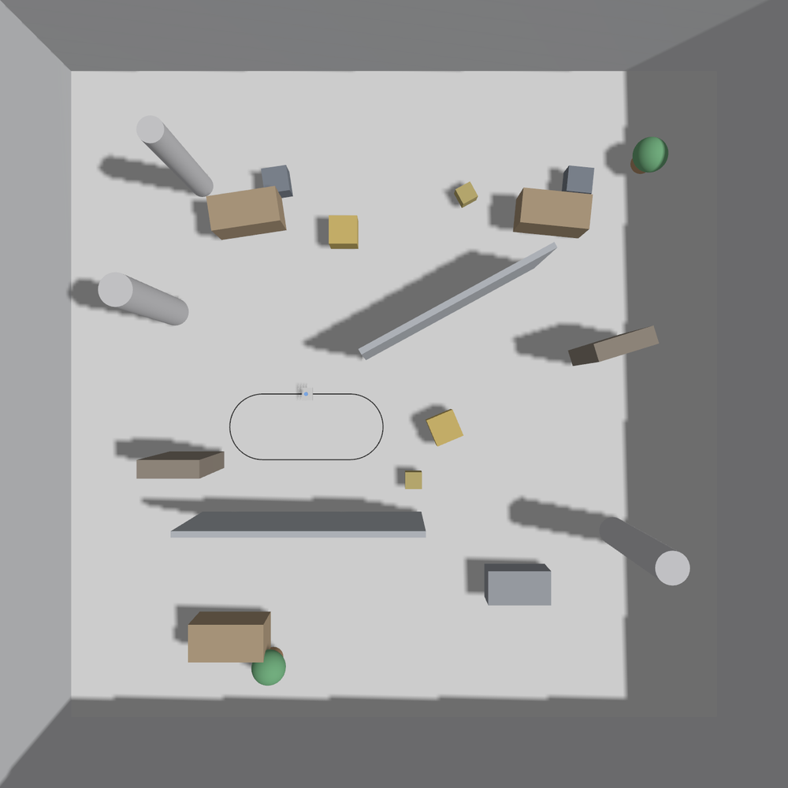
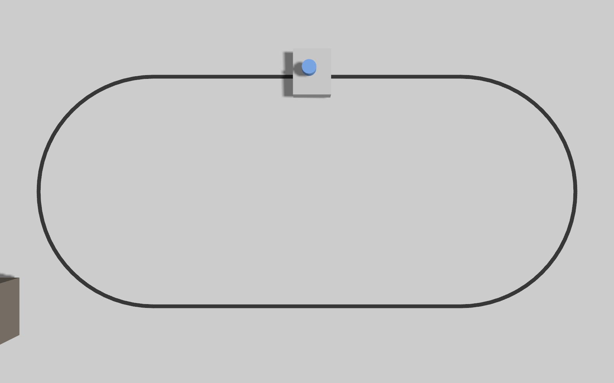

The `ugv_simulation` package runs the robot in Gazebo Harmonic on the development computer. Gazebo stands in for the
hardware: its differential drive takes the speed commands, and the lidar, IMU and line sensor are simulated on the same
topics as on the robot. The rest of the software (mode manager, EKF, slam_toolbox, Nav2, line following and the web
interface) runs unchanged, so mapping, navigation and line following can be tried without the robot.

<Frame caption="The office world from above. The line track is on the left, with the robot on it.">
  
</Frame>

## 1. Starting the Simulation

The simulation runs in the development environment of the repository (Ubuntu 24.04 and ROS 2 Jazzy in Distrobox).
Gazebo is installed only there, not on the robot. On the development computer, run the following in the repository
directory:

```bash
./setup.sh       # once: installs Docker and jetify-devbox
devbox shell     # installs Distrobox, Task and vcstool
task fetch       # third-party sources
task box         # creates and enters the development environment
task sim         # inside the development environment
```

The Gazebo window opens with the office world, and the web interface is at `http://localhost:8000`. Stop the
simulation with `Ctrl+C`.

<Note>
`task build`, `task sim` and the other ROS tasks run inside the development environment, whose prompt starts with 🚀.
Started on the computer itself, they stop with a message asking for `task box` first.
</Note>

### 1.1. Arguments

Arguments are added after `--`, for example `task sim -- nav:=true gui:=false`.

| Argument | Values | Description |
| --- | --- | --- |
| `gui` | `true` \| `false` | Gazebo window; `false` runs only the simulation, without a display |
| `nav` | `true` \| `false` | Nav2 (disabled by default) |
| `line` | `true` \| `false` | Simulated line sensor and line following |
| `x`, `y`, `yaw` | m, m, rad | Start pose; by default on the line track at (-1.6, 0) facing along the track |
| `world` | `<sdf>` | World file; by default the office world |
| `fusion`, `slam`, `slam_mode`, `map`, `gcs` | | As on the robot; see [Launch arguments](/en/projects/ugv-ros/usage#1-1-launch-arguments) |

## 2. Using the Simulation

### 2.1. Mapping

Switch to **Manual** mode in the web interface and drive with the keyboard, the on-screen buttons or a gamepad. The
map grows as the robot moves. slam_toolbox adds a new scan only after the robot has moved about 0.15 m, so the map
does not grow while the robot turns in place. Maps saved with the **Save map** panel go to `.distrobox/ugv_maps` in the
repository, the home directory of the development environment.

### 2.2. Line following

The robot starts on a black line track with two 1.6 m straights and two 0.6 m radius turns. Select the **Line follow**
mode and the robot follows the track with the same controller and parameters (`control.yaml`) as on the robot. The
line sensor panel of the web interface shows the eight channels.

<Frame caption="The line track and the robot at its start pose.">
  
</Frame>

### 2.3. Navigation

Start the simulation with `task sim -- nav:=true`. After building a map in **Manual** mode, enable **Click → goal** and
click a point on the map; the robot plans a path and drives there.

## 3. What Is Simulated

| On the robot | In the simulation | Topics |
| --- | --- | --- |
| Motors and encoders (`ugv_base_node`) | Gazebo differential drive | `/cmd_vel` → `/wheel/odom`, `/joint_states` |
| ICM-20948 IMU (`ugv_imu_node`) | Gazebo IMU, mounted like the real one | `/imu/data_raw` |
| RPLIDAR A1 (`sllidar_ros2`) | Gazebo lidar: 360 samples, 0.15–12 m, 8 Hz | `/scan` |
| Pololu QTR-8A line sensor (`line_sensor_node`) | A downward camera at the sensor array; `line_sensor_sim` turns its image into eight channels | `/line/state` |

The robot model comes from `ugv_description`, so changes to `config/robot.yaml` apply to the simulation as well; the
masses are estimates. The line sensor calibration and lidar connection panels of the web interface, and the
`hw_check` and `line_check` tools, need the hardware and do not work in the simulation.

## 4. Troubleshooting

<AccordionGroup>
  <Accordion title="Why does task sim ask for task box first?">
    The command was started on the computer itself. ROS 2 and Gazebo are only in the development environment: enter
    it with `task box` and run `task sim` there, at the prompt that starts with 🚀.
  </Accordion>
  <Accordion title="Why doesn't the web interface open at http://localhost:8000?">
    Another program is using port 8000, so the simulation could not start its web server. Stop that program and start
    `task sim` again.
  </Accordion>
  <Accordion title="Why doesn't the map grow?">
    slam_toolbox adds a new scan only after the robot has moved about 0.15 m, so turning in place does not grow the
    map. Drive the robot forward.
  </Accordion>
</AccordionGroup>
