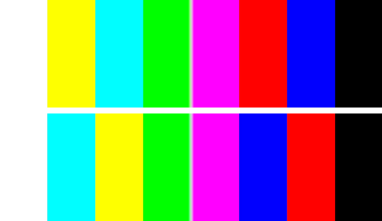

<Tip>
Bölüm bitiminde aşağıdaki konularda bilgi sahibi olacaksınız.

* DCC dosyalarının ne içerdiği ve hangi bileşenin neye bağlı olduğu
* Yeni bir sensör için başlangıç ayarının nasıl oluşturulduğu
* Bayer sırasının demozaik ayarına etkisi
</Tip>

## 1. DCC Dosyaları

VISS ve 2A algoritmaları, TI'nin `dcc_gen_linux` aracıyla XML kaynaklarından derlenen DCC (Dynamic Camera
Configuration) dosyalarıyla yapılandırılır. Her sensörün `/opt/imaging/<sensör>/linear/` dizininde iki dosyası,
lens distorsiyon ayarı olan sensörlerde ise ek olarak `dcc_ldc.bin` dosyası bulunur.

| Dosya | Kullanan | İçerik |
|-------|----------|--------|
| `dcc_viss.bin` | `tiovxisp dcc-isp-file` | Aşağıdaki tüm VISS blokları |
| `dcc_2a.bin` | `tiovxisp sink_0::dcc-2a-file` | AWB ayarı ve H3A ızgarası |
| `dcc_ldc.bin` | `tiovxldc dcc-file` | Lens distorsiyon ağı (isteğe bağlı, lense özgü) |

| Bileşen | Bağlı olduğu | Not |
|---------|--------------|-----|
| `VISS_BLC` siyah seviyesi | Sensör, **bit derinliği** | Giriş biriminde −siyah seviyesi: IMX219 −64 (10 bit), OV5647 −16 (10 bit), IMX477 −256 (12 bit) |
| `VISS_RAWFE_DECOMPAND` | **Bit derinliği** | TI'nin 10 bit ayarı veriyi bir LUT ile 16 bite genişletir; 12 bit doğrusal ayarı bloğu kapatır |
| `VISS_H3A_MUX_LUTS_CFG` | **Bit derinliği** | Veriyi H3A'nın 10 bitlik girişine eşler |
| `VISS_CFA` | **Bit derinliği**, **Bayer sırası** | Demozaik katsayıları: 2x2 Bayer hücresinin her fazı için 6x6 çekirdek |
| `VISS_NSF4` | Sensör gürültüsü, **bit derinliği** | Gürültü eşikleri |
| `VISS_H3A_AEWB_CFG` | **Kare boyutu** | İstatistik pencereleri piksel cinsindendir |
| `VISS_RGB2RGB` | Sensörün renk yanıtı | Renk düzeltme matrisi, renk kartından çıkarılır |
| `VISS_GAMMA` | Tercih | Çıkış ton eğrisi |
| `AWB_ALG_TI3_TUNING` | Sensörün renk yanıtı | Gri kart çekimlerinden AWB referans ışıkları |
| `LDC_MESH` | Lens | Yalnızca sabit lensler için |

<Warning>
Her bileşenin başlığındaki `camera_module_id`, tanımlayıcıdaki `[isp] dcc-id` ile aynı olmalıdır. Uyuşmazlıkta
TI'nin ayrıştırıcısı o bileşende durur, "Invalid Camera Id" yazar ve ISP varsayılan değerlerle çalışır. Hat
çalışmaya devam ettiği için tek belirti kötü bir görüntüdür. `camera-isp-sdk validate` bu durumu derlemeden önce
yakalar.
</Warning>

```bash
task dcc SENSORS=ov5647
./camera-isp-sdk dcc inspect build/dcc/ov5647/dcc_viss.bin --dcc-id 5647
```

## 2. Yeni Sensör İçin Başlangıç Ayarı

`camera-isp-sdk new --dcc-from <sensör>` başka bir sensörün kaynaklarını kopyalar; modül kimliğini yeniden yazar,
H3A ızgarasını kare boyutuna uydurur ve demozaik katsayılarını yeni sensörün Bayer sırasına taşır. Bu ilk
görüntüyü verir. Bu uyarlamalar dışında yalnızca **bit derinliğine bağlı** bileşenler, o da yalnızca kaynak
sensör aynı bit derinliğindeyse doğru olabilir:

* 10 bit sensörler: `imx230` (TI'nin IMX219 10 bit hattı)
* 12 bit sensörler: `imx477` (TI'nin IMX390 12 bit doğrusal ayarı)

LDC kopyalanmaz; ağ kaynak sensörün lensine aittir. Ardından siyah seviyesi sensöre göre ayarlanır: veri
sayfasından veya libcamera ayar dosyasındaki `black_level` değeri sensörün bit derinliğine indirgenerek. Renk ve
beyaz dengesi sensör ayarlanana kadar kaynak sensörünkidir.

## 3. Bayer Sırası

VISS'in demozaik bloğu Bayer sırasını görüntünün kendisinden bilmez. CFA bileşeni 2x2 hücrenin her fazı için ayrı
bir çekirdek içerir ve bu çekirdekler tek bir Bayer sırası için hazırlanır: TI'nin IMX219 ve IMX390 ayarlarında
RGGB, AR0233 ve AR0820 ayarlarında GRBG. `tiovxisp` caps'teki Bayer sırasını yalnızca 2A'ya (H3A istatistikleri,
beyaz dengesi kazançları) iletir. Başka bir sıra için hazırlanmış katsayılar, renkleri yanlış piksellerden alır.

<Frame caption="OV5647 renk çubuğu test deseni ISP çıkışında. Üstte BGGR katsayıları, altta imx230'dan kopyalanan RGGB katsayıları: sarı ile camgöbeği, kırmızı ile mavi yer değiştirir.">
  
</Frame>

Dört Bayer sırası aynı mozaiğin bir piksel yatay ve/veya dikey kaydırılmış hâlidir; her pikselin komşuluğu, dolayısıyla
çekirdeği aynı kalır ve yalnızca bulunduğu faz değişir. `camera-isp-sdk dcc fit-cfa` bu yüzden çekirdekleri yalnızca
yeni fazlarına taşır. `[mode] code` değiştirildiğinde çalıştırılmalıdır; `camera-isp-sdk validate`, katsayılar ile
tanımlayıcı uyuşmadığında hata verir.

```bash
./camera-isp-sdk dcc fit-cfa ov5647
```

Sensör modu değiştirildiğinde ise istatistik ızgarası yeni kare boyutuna uydurulmalıdır.

```bash
./camera-isp-sdk dcc fit-h3a ov5647
```

## 4. Sensöre Özgü Ayar

TI'nin DCC Tuning Tool aracı (TI'den talep üzerine edinilir) yukarıdaki tüm XML dosyalarını çekimlerden üretir.

1. Kartta pozlama ve kazancı her sahne için elle ayarlayarak ISP'siz ham kareler yakalayabilirsiniz.

   ```bash
   sudo su
   source /opt/t3-edgeai-env
   camera-isp-sdk setup ov5647
   v4l2-ctl -d /dev/v4l-ov5647-subdev0 -c exposure=1000,analogue_gain=16
   v4l2-ctl -d /dev/video-ov5647-cam0 --stream-mmap --stream-skip=30 \
       --stream-count=1 --stream-to=kare.raw
   ```

2. Aracın istediği çekimleri yapabilirsiniz: karanlık kareler (siyah seviyesi, gürültü), farklı ışıklar altında Macbeth
   renk kartı (renk matrisi, AWB) ve gerekiyorsa düz alan (lens gölgelemesi).
3. Üretilen XML dosyalarında `camera_module_id` değerini tanımlayıcının `dcc-id` değeriyle eşlemeniz gerekir;
   ardından dosyaları `sensors/<sensör>/dcc/linear/` altındakilerin yerine koyabilirsiniz.
4. Kaynakları `./camera-isp-sdk validate` ile denetleyip `task dcc` ile yeniden derleyebilir ve sonucu kartta karşılaştırabilirsiniz.
