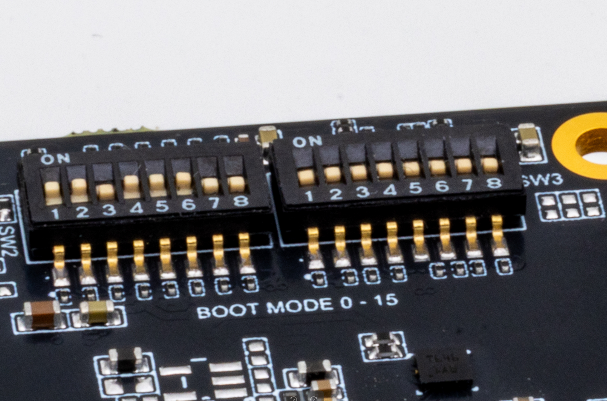
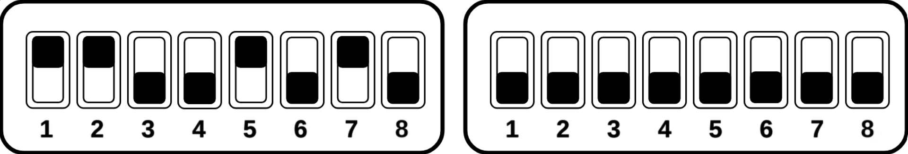
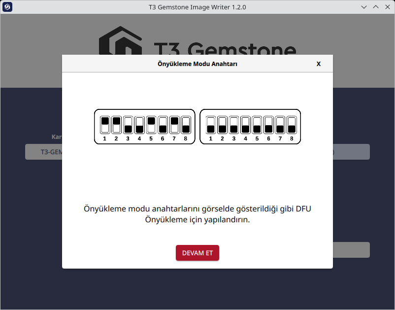
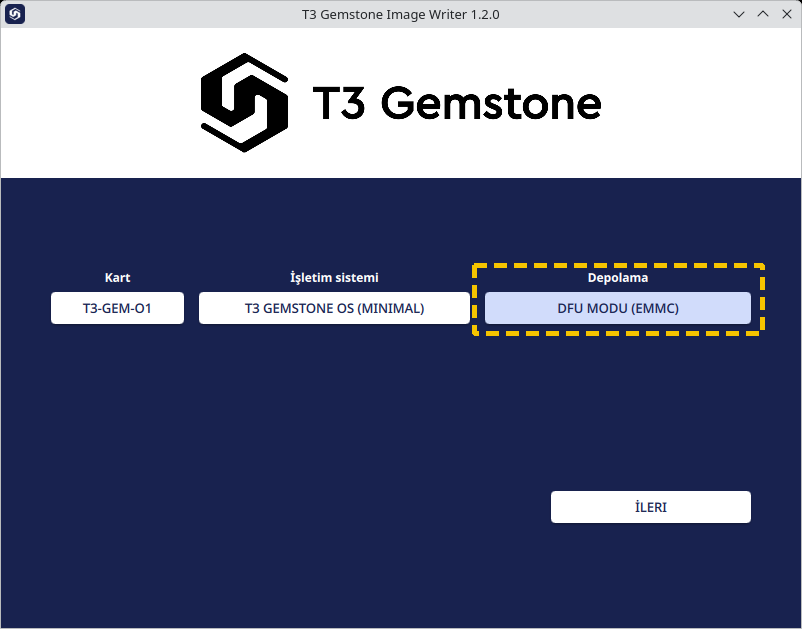
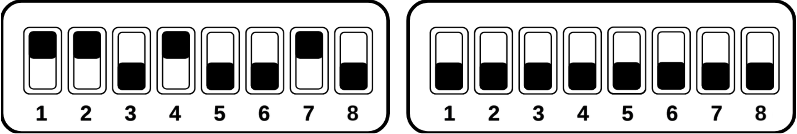
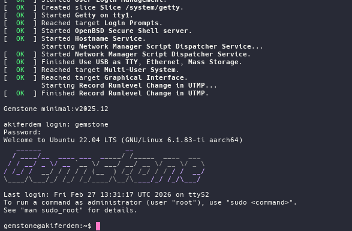

<Tip>
Bölüm bitiminde Gemstone geliştirme kartında eMMC üzerine imaj yazma işlemi hakkında bilgi sahibi olacaksınız.
</Tip>

Gemstone işletim sisteminin SD kartın yanı sıra eMMC üzerinden de boot edilebilme desteği bulunmaktadır.
eMMC, yüksek performanslı ve güvenilir bir depolama çözümüdür. SD karta kıyasla daha hızlı veri erişimi ve daha
sağlam fiziksel yapı sunması nedeniyle birçok uygulamada öncelikli olarak tercih edilmektedir.

## 1. USB DFU ile eMMC'ye İmaj Yazma

USB DFU (Device Firmware Upgrade), T3 Gemstone O1'in USB üzerinden doğrudan programlanmasını sağlayan standarttır.
SD karta veya çalışan bir sisteme gerek kalmadan eMMC'ye imaj yazılabilir.

<Note>
  TI AM67A işlemcisi için resmi DFU dökümanı:
  [USB Device Firmware Upgrade (DFU) — Processor SDK Linux for AM67A](https://software-dl.ti.com/jacinto7/esd/processor-sdk-linux-am67a/10_00_00/exports/docs/linux/Foundational_Components/U-Boot/UG-DFU.html)
</Note>

### 1.1. USB DFU Moduna Geçiş

<Warning>
  **İşleme başlamadan önce kartı tamamen kapatınız.**
  Kart çalışırken DFU moduna geçmeye çalışmak eMMC'yi bozabilir.
</Warning>

<Steps>
  <Step title="Kartı kapatınız">
    İşletim sistemi çalışıyorsa düzgün biçimde kapatınız, ardından T3 Gemstone O1'in güç bağlantısını kesiniz.
  </Step>

  <Step title="Bootmode switch'i USB DFU konumuna getiriniz">
    Aşağıdaki diyagramda gösterilen switch pozisyonunu referans alarak bootmode switch'i USB DFU konumuna getiriniz.

    <Frame caption="Bootmode switch fiziksel konumu (temsili)">
      
    </Frame>

    <Note>
      Yukarıdaki görsel, bootmode switch'in kart üzerindeki fiziksel konumunu göstermek amacıyla eklenmiştir ve temsilidir.
      DFU modu için switch pozisyonunu aşağıdaki diyagramdan takip ediniz.
    </Note>

    <Frame caption="USB DFU boot modu switch pozisyonu">
      
    </Frame>
  </Step>

  <Step title="USB-C kablosunu bağlayarak güç veriniz">
    USB-C kablosunu kartın DFU portuna ve bilgisayarınıza takınız, ardından güç veriniz.
  </Step>

</Steps>

### 1.2. T3 Gemstone Imager ile İmaj Yükleme

T3 Gemstone Imager tüm yazma sürecini kendisi yönetir. Önyükleyici dosyalarını (`tiboot3.bin`, `tispl.bin`,
`u-boot.img`) DFU ile karta gönderir, ardından kartı **USB yığın depolama (UMS)** moduna alır. Bu modda kartın eMMC'si
bilgisayara bir disk olarak görünür ve imaj bir SD karta yazılır gibi doğrudan yazılıp doğrulanır.

<Note>
  UMS ile yazma DFU ile yazmadan çok daha hızlıdır: 1 GB'lık minimal imaj yaklaşık 30 saniyede, 4 GB'lık masaüstü
  imajı yaklaşık 2 dakikada yazılır. Önyükleyici UMS desteklemiyorsa (eski imajlar) imaj otomatik olarak DFU ile
  gönderilir; bu yöntem çok daha yavaştır ancak yapmanız gereken adımlar aynıdır.
</Note>

<Steps>
  <Step title="T3 Gemstone Imager'ı açınız">
    Uygulamayı [t3gemstone.org/tr/software](https://t3gemstone.org/tr/software) adresinden indirip kurunuz
    ve açınız. **Kart** başlığı altındaki **AYGIT SEÇİN** butonundan **T3-GEM-O1**'i seçiniz.

    <Note>
      Uygulamayı yönetici olarak çalıştırmanız gerekmez; gereken izinler yazma sırasında istenir.
      Ayrıntılar için aşağıdaki **1.3. İşletim Sistemine Göre İzinler** bölümüne bakınız.
    </Note>
  </Step>

  <Step title="İşletim sistemi imajını seçiniz">
    **İŞLETİM SİSTEMİ SEÇİN** butonuna tıklayarak yüklemek istediğiniz imajı seçiniz. Listedeki imajlar internetten
    indirilir; bilgisayarınızdaki bir `.img` veya `.img.xz` dosyasını da seçebilirsiniz.
  </Step>

  <Step title="Hedef olarak DFU modunu seçiniz">
    **HEDEF SEÇİN** butonuna tıklayınız ve **DFU Modu (eMMC)** seçeneğini seçiniz. Açılan **Önyükleme Modu Anahtarı**
    penceresi, DFU modu için switch konumunu gösterir. Kartın switch'lerinin bu konumda olduğunu kontrol edip
    **DEVAM ET** butonuna tıklayınız.

    <Frame>
      
    </Frame>

    <Frame>
      
    </Frame>
  </Step>

  <Step title="İmajı yazınız">
    **İleri** butonuna tıklayarak OS özelleştirme seçeneklerini yapılandırınız ([Özelleştirme](/tr/imager/customization)
    sayfasına bakınız), ardından yazma işlemini başlatınız.

    Yazma sırasında uygulama sırasıyla şu adımları gösterir:

    1. **Önyükleyici dosyaları alınıyor...**: Önyükleyici, seçilen imaj bilgisayarınızdaysa imajın içinden,
       değilse sunucudan alınır ve özeti (SHA-256) kontrol edilir.
    2. **bootloader / tispl.bin / u-boot.img gönderiliyor...**: Önyükleyici aşamaları DFU ile karta gönderilir.
    3. **Kart USB yığın depolama moduna geçiriliyor...**: Kart eMMC'yi bir disk olarak sunar.
    4. **İmaj USB yığın depolama üzerinden karta yazılıyor...**: İmaj yazılır ve ardından doğrulanır.
    5. **Kart eMMC'ye yazıyor (gücü kesmeyin)...**: Kart, önbelleğindeki son verileri eMMC'ye yazar.

    <Warning>
      Yazma işlemi sırasında USB kablosunu çıkarmayınız veya güç bağlantısını kesmeyiniz. Yazma sırasında
      bilgisayarınızda görünen diski çıkarmayınız, biçimlendirmeyiniz; uygulama yazma bitince diski kendisi çıkarır.
    </Warning>
  </Step>

  <Step title="Tamamlanmasını bekleyiniz">
    Yazma bittiğinde uygulama **İmaj eMMC'ye başarıyla yazıldı!** mesajını gösterir.
  </Step>

  <Step title="Kartı kapatıp bootmode switch'i eMMC konumuna alınız">
    Kartın gücünü kesiniz, ardından bootmode switch'i aşağıdaki görselde gösterildiği gibi
    **eMMC** konumuna getiriniz.

    <Frame caption="eMMC boot modu switch pozisyonu">
      
    </Frame>

    <Note>
      Boot işlemini UART üzerinden seri port bağlantısıyla takip edebilirsiniz.
      Varsayılan baudrate: **115200**
    </Note>

    Güç verdikten sonra kart eMMC üzerindeki imajdan açılacaktır.

    <Frame caption="DFU transfer sırasında seri port çıktısı">
      
    </Frame>

    UART bağlantısı hakkında daha fazla bilgi için [Seri Port](/tr/boards/o1/peripherals/serial) sayfasına bakın.
  </Step>
</Steps>

### 1.3. İşletim Sistemine Göre İzinler

<Tabs>
  <Tab title="Windows">
    - Uygulama açılırken Windows yönetici onayı (UAC) ister.
    - Kurulum programı, kartın DFU arayüzü için gereken **WinUSB** sürücüsünü de kurar. Ayrıca
      [Zadig](https://zadig.akeo.ie/) ile sürücü kurmanız gerekmez.
    - Kurulumda **DFU sürücüsü (USB ile yazma)** seçeneğinin işaretini kaldırdıysanız uygulama karta ulaşamadığını
      bildirir. Bu durumda kurulum programını yeniden çalıştırıp bu seçeneği seçili bırakınız; kartın gücünü
      kesmeniz gerekmez.
  </Tab>
  <Tab title="Linux">
    - İlk DFU yazma işleminde, kartın DFU arayüzüne erişim için gereken udev kuralını yüklemek üzere yönetici
      şifreniz bir kez sorulur.
      Şifre girilmezse uygulama *"Kimlik doğrulama başarısız veya iptal edildi"* hatası verir.
    - İmaj UMS ile yazılırken diske erişim için yönetici şifresi istenebilir.
  </Tab>
  <Tab title="macOS">
    - **.dmg** dosyasını açıp **T3 Gemstone Imager**'ı **Uygulamalar** klasörüne sürükleyiniz.
    - Apple Silicon (M serisi) Mac'lerde kart ilk takıldığında macOS *"Aksesuarın bağlanmasına izin verilsin mi?"*
      diye sorar. **İzin Ver**'i seçiniz; aksi halde uygulama kartı DFU modunda bulamaz. Soruyu kaçırdıysanız USB
      kablosunu çıkarıp yeniden takınız.
    - Kart UMS moduna geçtiğinde macOS, diske yazmak için yönetici şifrenizi ister.
    - Yazma sırasında kartın diski Finder'da bağlanmaz ve "okunamayan disk" uyarısı çıkmaz; uygulama diski
      yazma bitince kendisi çıkarır.
  </Tab>
</Tabs>

### 1.4. Olası Hatalar

| Mesaj | Yapılması gereken |
|-------|-------------------|
| Önyükleyici dosyası indirilemedi | İnternet bağlantınızı kontrol edip yeniden deneyiniz. İndirilen dosyanın özeti beklenenle eşleşmezse de bu hata verilir. |
| Kart USB yığın depolama moduna geçti, ancak ... disk görünmedi | Kartın gücünü kesiniz, bootmode switch'i yeniden DFU konumuna alıp güç veriniz ve yeniden deneyiniz. |
| ... gönderilirken DFU aktarımı başarısız oldu | Kartın gücünü kesiniz, bootmode switch'i yeniden DFU konumuna alıp güç veriniz ve yeniden deneyiniz. |
| Aktarım bittikten ... dakika sonra kart hâlâ eMMC'ye yazıyor | Kartın gücünü **kesmeyiniz**; seri porttan takip edip yazma bitene kadar bekleyiniz. |

Uygulama her oturumun kaydını bir log dosyasına yazar. Sorun bildirirken bu dosyayı
[gem-imager](https://github.com/t3gemstone/gem-imager/issues) deposuna eklemeniz sorunun çözümünü hızlandırır.

## 2. SDK ile Manuel İmaj Yükleme (dfu-util)

<Warning>
  Bu yöntem, SDK derleme sistemi ile çalışan Geliştiriciler içindir.
</Warning>

<Note>
  Kaynak koddan imaj derleme hakkında daha fazla bilgi için [SDK belgelerine](/tr/sdk/introduction) bakınız.
</Note>

Kartı [1.1. USB DFU Moduna Geçiş](#1-1-usb-dfu-moduna-geçiş) adımlarında anlatıldığı şekilde
bootmode switch üzerinden DFU moduna alınız, ardından aşağıdaki komutları sırasıyla çalıştırınız.

Başarılı bir SDK derlemesinin ardından gereken dosyalar iki dizinde bulunur:

| Dosya | Konum |
|-------|-------|
| `tiboot3.bin` | `build/t3-gem-o1/deploy-ti/images/t3-gem-o1/` |
| `tispl.bin` | `build/t3-gem-o1/deploy-ti/images/t3-gem-o1/` |
| `u-boot.img` | `build/t3-gem-o1/deploy-ti/images/t3-gem-o1/` |
| `gemstone-*.img` | `build/debos/` |

<Steps>
  <Step title="İlk aşama önyükleyiciyi (tiboot3.bin) yükleyiniz">
    ```bash
    sudo dfu-util -d 0451:6165 -a bootloader -D tiboot3.bin -R
    ```

    Bu adımın ardından kart sıfırlanarak yeniden bağlanacaktır. Birkaç saniye bekleyip
    `dfu-util -l` ile kartın hâlâ görünür olduğunu doğrulayınız.
  </Step>

  <Step title="TI SPL'i (tispl.bin) yükleyiniz">
    ```bash
    sudo dfu-util -d 0451:6165 -a tispl.bin -D tispl.bin -R
    ```
  </Step>

  <Step title="U-Boot'u (u-boot.img) yükleyiniz">
    ```bash
    sudo dfu-util -d 0451:6165 -a u-boot.img -D u-boot.img -R
    ```
  </Step>

  <Step title="OS imajını eMMC'ye aktarınız">
    `<imaj-dosya-adı>` kısmını kendi imaj dosyanızın adıyla değiştiriniz:

    ```bash
    sudo dfu-util -d 0451:6165 -a rawemmc \
        -D <imaj-dosya-adı>.img -R
    ```

    <Warning>
      Bu adım tüm OS imajını USB üzerinden eMMC'ye aktarır. Aktarımı kesintiye uğratmayınız.
      İmaj boyutuna ve USB hızına bağlı olarak bu işlem birkaç dakika sürebilir.
    </Warning>
  </Step>

  <Step title="Kartı kapatıp bootmode switch'i eMMC konumuna alınız">
    `dfu-util` başarı bildirdiğinde kartı tamamen kapatınız, ardından bootmode switch'i
    **eMMC** konumuna getiriniz.

    <Frame caption="eMMC boot modu switch pozisyonu">
      
    </Frame>

    <Note>
      Boot işlemini UART üzerinden seri port bağlantısıyla takip edebilirsiniz.
      Varsayılan baudrate: **115200**
    </Note>

    Güç verdikten sonra kart eMMC üzerindeki imajdan açılacaktır.
  </Step>
</Steps>

### 2.1. Doğrulama Adımı

Komutları çalıştırmadan önce kartın DFU cihazı olarak göründüğünü doğrulayınız.

<Step title="DFU cihazını doğrulayınız">
  Kartın DFU cihazı olarak göründüğünü doğrulayınız.

  <Tabs>
    <Tab title="Linux">
      `dfu-util` isimli uygulama yüklü değilse, `sudo apt install dfu-util` komutu ile Ubuntu bilgisayarınıza yükleyiniz.

      ```bash
      sudo dfu-util -l
      ```
    </Tab>
    <Tab title="Windows">
      `dfu-util` Windows ikili dosyasını [dfu-util ana sayfasının](https://dfu-util.sourceforge.net/)
      Releases bölümünden indirip zip'i çıkartınız, ardından çalıştırınız:

      ```powershell
      dfu-util.exe -l
      ```

      <Note>
        Windows'ta `dfu-util.exe -l` çıktısı boş geliyorsa cihaza **WinUSB** sürücüsü yüklenmemiştir. T3 Gemstone
        Imager kurulumu bu sürücüyü yükler; Imager'ı kurmadıysanız sürücüyü [Zadig](https://zadig.akeo.ie/) ile
        yükleyebilirsiniz:

        1. [zadig.akeo.ie](https://zadig.akeo.ie/) adresinden Zadig'i indirip çalıştırınız
            (kurulum gerektirmez; UAC yönetici onayı isteyecektir)
        2. Kart listede görünmüyorsa **Options → List All Devices** seçeneğini etkinleştiriniz
        3. Açılır listeden VID `0451` / PID `6165` olan cihazı seçiniz
        4. Sürücü olarak **WinUSB**'ı seçip **Install Driver** butonuna tıklayınız
        5. Yükleme tamamlandığında sürücü adı yeşil renkte görüntülenecektir
      </Note>
    </Tab>
  </Tabs>

  VID:PID **0451:6165** ile `bootloader` ve `SocId` alt ayarlarını içeren bir giriş
  görmeniz gerekmektedir.

  ```
  Found DFU: [0451:6165] ver=0200, devnum=9, cfg=1, intf=0, path="1-2.2", alt=1, name="SocId", serial="01.00.00.00"
  Found DFU: [0451:6165] ver=0200, devnum=9, cfg=1, intf=0, path="1-2.2", alt=0, name="bootloader", serial="01.00.00.00"
  ```

  Cihaz listede görünmüyorsa 1. adımdan itibaren tekrar deneyiniz.
</Step>
