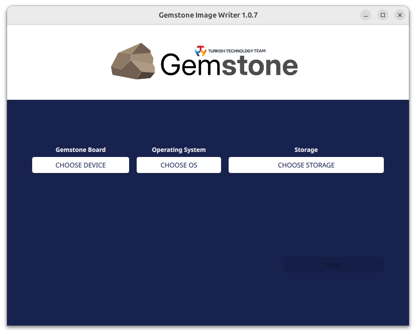

Gemstone imajlarının seçilmesi, indirilmesi, özelleştirilmesi ve bir SD Karta veya destekleyen kartlarda kart
üzerinde yerleşik bulunan depolama aygıtına yazılması işlemlerinin tek bir yerden kolayca yapılabilmesi için
T3 Gemstone Imager uygulaması yazılmıştır. Linux, Windows ve macOS üzerinde çalışabilir ve kullanımı kolaydır.

Uygulamayı [t3gemstone.org/tr/software](https://t3gemstone.org/tr/software) adresinden indirebilirsiniz:

| İşletim sistemi | Paket |
|-----------------|-------|
| Linux | `.AppImage` |
| Windows | `.exe` kurulum programı (kartın DFU sürücüsünü de kurar) |
| macOS | `.dmg` (Apple Silicon ve Intel) |

T3-GEM-O1'in eMMC'sine kart USB-C ile bilgisayara bağlıyken yazmak için [eMMC Kullanımı](/tr/imager/emmc)
sayfasına bakınız.

<Frame>
  
</Frame>
