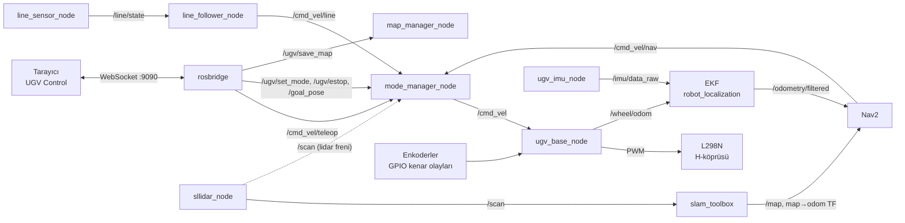
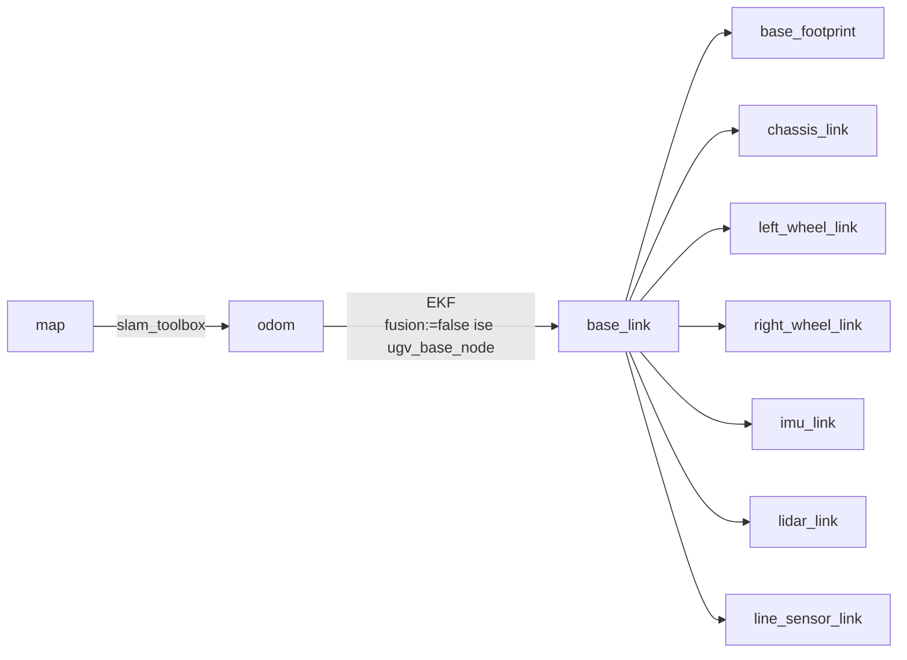

## 1. Paketler

| Paket | Tür | Görev |
| --- | --- | --- |
| `ugv_interfaces` | msg/srv | `LineState`, `LidarStatus`, `SetMode`, `SaveMap`, `SetLidar` |
| `ugv_description` | URDF | Robot modeli; geometri için tek kaynak `config/robot.yaml` |
| `ugv_hal` | Python kütüphanesi | GPIO (libgpiod v1/v2, hat adıyla çözümleme), sysfs PWM (modül adıyla), `mock`; `lidar_manager_node` (USB / GPIO lidar seçimi) |
| `ugv_base` | Python | Enkoder geri beslemeli teker hız kontrolü, teker odometrisi, `hw_check` |
| `ugv_imu` | C++ | ICM-20948 SPI sürücüsü, jiroskop sapma kalibrasyonu |
| `ugv_line` | Python | 8 kanallı sensör dizisi (Deneyap Kart ADC → UART, dijital eşik ya da QTR-8RC RC zamanlama), PD çizgi izleme, `line_check` |
| `ugv_control` | Python | Mod yöneticisi: komut çoklayıcı, acil durdurma, lidar freni |
| `ugv_navigation` | config + Python | slam_toolbox, Nav2, harita kaydetme servisi |
| `ugv_gcs` | web + Python | Tarayıcı arayüzü, rosbridge, robot konumu yayını |
| `ugv_bringup` | launch + config | Tek başlatma dosyası; tüm pinler `config/hardware.yaml` dosyasında |

Donanımdan bağımsız mantık (kinematik, PID, enkoder çözümleme, çizgi konumu, çoklayıcı, fren) ROS'tan bağımsız
modüllerde yer alır ve `pytest` ile test edilir.

## 2. Veri Akışı

`mode_manager_node`, aktif moda göre yalnızca ilgili kaynaktan gelen hız komutunu `/cmd_vel` konusuna aktarır; acil
durdurma ve lidar freni de bu düğümde uygulanır.

## 3. Sürüş Modları

| Mod | Motorlara ulaşan komut | Nasıl girilir |
| --- | --- | --- |
| `idle` | Hiçbiri | Açılış, acil durdurma sonrası, arayüz |
| `manual` | `/cmd_vel/teleop` | Arayüz ya da herhangi bir modda sıfırdan farklı teleop komutu |
| `line` | `/cmd_vel/line` | Arayüz |
| `nav` | `/cmd_vel/nav` | Arayüzde haritaya tıklama veya `/goal_pose` |

- Acil durdurma tüm modlardan önce gelir ve mod `idle` olur.
- `nav` modundan çıkıldığında Nav2 hedefleri iptal edilir.
- Lidar freni (varsayılan olarak **açık**, `control.yaml` → `safety.enabled`) her modda ileri/geri hızı
  sınırlar. Engel yalnızca robotun gideceği koridorda (gövde genişliği + pay) aranır ve mesafe gövdenin ön/arka
  ucundan ölçülür. Yandaki duvar sürüşü engellemez, dönüş hiç kısıtlanmaz (`control.yaml` → `safety`, gövde ölçüleri
  `robot.yaml`).

### 3.1. Yön kuralı

Tüm `/cmd_vel*` komutları ve kinematik hesapları REP-103 kuralına uyar: `linear.x > 0` ileri, `angular.z > 0`
yukarıdan bakıldığında saat yönünün tersine (sola) dönüştür.

<Note>
**Tek istisna web arayüzünün tuş eşlemesidir.** Geri giderken sol/sağ tuşları araba direksiyonu gibi davranır; sol
tuşu aracın arkasını sola götürür (`angular.z < 0`). Bu çeviri yalnızca tarayıcıda (`app.js` → `steering`) yapılır;
robota giden komut yine REP-103 kuralına uyar. Çizgi izleme ve Nav2 bu çeviriden geçmez.
</Note>

## 4. TF Ağacı

`base_link` altındaki dönüşümler `robot_state_publisher` tarafından yayınlanır.

## 5. Konular ve Servisler

| İsim | Tip | Yayıncı / Sunucu |
| --- | --- | --- |
| `/cmd_vel` | `geometry_msgs/Twist` | mode_manager_node |
| `/wheel/odom` | `nav_msgs/Odometry` | ugv_base_node |
| `/ugv_base_node/wheels` | `std_msgs/Float32MultiArray` | ugv_base_node (PID ayarı için) |
| `/imu/data_raw` | `sensor_msgs/Imu` | ugv_imu_node |
| `/odometry/filtered` | `nav_msgs/Odometry` | ekf_filter_node |
| `/scan` | `sensor_msgs/LaserScan` | sllidar_node (lidar_manager_node başlatır) |
| `/ugv/lidar` | `ugv_interfaces/LidarStatus` (latched) | lidar_manager_node |
| `/line/state` | `ugv_interfaces/LineState` | line_sensor_node |
| `/line_follower/status` | `std_msgs/String` | line_follower_node |
| `/ugv/mode` | `std_msgs/String` (latched) | mode_manager_node |
| `/ugv/estop_active` | `std_msgs/Bool` (latched) | mode_manager_node |
| `/ugv/obstacle_distance` | `std_msgs/Float32` | mode_manager_node |
| `/ugv/robot_pose` | `geometry_msgs/PoseStamped` | robot_pose_node |
| `/ugv/set_mode` | `ugv_interfaces/SetMode` | mode_manager_node |
| `/ugv/estop` | `std_srvs/SetBool` | mode_manager_node |
| `/ugv/save_map` | `ugv_interfaces/SaveMap` | map_manager_node |
| `/ugv/reset_map` | `std_srvs/Trigger` | map_manager_node (EKF konumu ve haritalama modunda SLAM haritası) |
| `/ugv/set_lidar` | `ugv_interfaces/SetLidar` | lidar_manager_node |
| `/line/calibrate_white` | `std_srvs/Trigger` | line_sensor_node |
| `/line/calibrate_black` | `std_srvs/Trigger` | line_sensor_node |
| `/line/calibration_status` | `std_msgs/String` (JSON) | line_sensor_node |

## 6. Yapılandırma Dosyaları

| Dosya | İçerik |
| --- | --- |
| [`ugv_bringup/config/hardware.yaml`](https://github.com/t3gemstone/ugv-ros/blob/main/src/ugv_bringup/config/hardware.yaml) | Pinler, PWM kanalları, motor/enkoder ayarları, PID, çizgi sensörü ve lidar bağlantısı |
| [`ugv_bringup/config/control.yaml`](https://github.com/t3gemstone/ugv-ros/blob/main/src/ugv_bringup/config/control.yaml) | Mod yöneticisi ve lidar freni (`safety`), çizgi izleme kazançları, harita yöneticisi |
| [`ugv_bringup/config/ekf.yaml`](https://github.com/t3gemstone/ugv-ros/blob/main/src/ugv_bringup/config/ekf.yaml) | robot_localization EKF ayarları |
| [`ugv_description/config/robot.yaml`](https://github.com/t3gemstone/ugv-ros/blob/main/src/ugv_description/config/robot.yaml) | Teker yarıçapı, teker açıklığı, gövde ölçüleri, IMU ve lidar yerleşimi |
| [`ugv_navigation/config/slam.yaml`](https://github.com/t3gemstone/ugv-ros/blob/main/src/ugv_navigation/config/slam.yaml) | slam_toolbox ayarları |
| [`ugv_navigation/config/nav2.yaml`](https://github.com/t3gemstone/ugv-ros/blob/main/src/ugv_navigation/config/nav2.yaml) | Nav2 ayarları |
