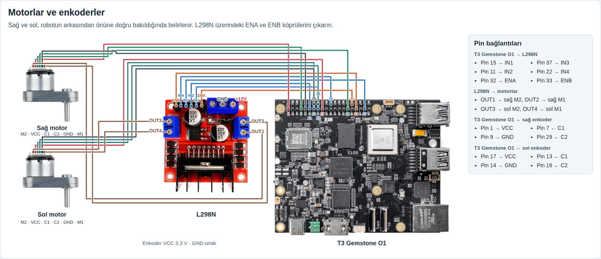
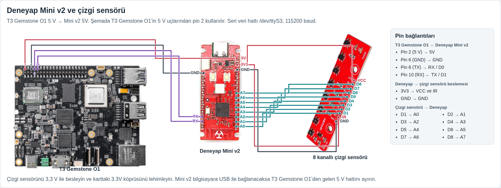
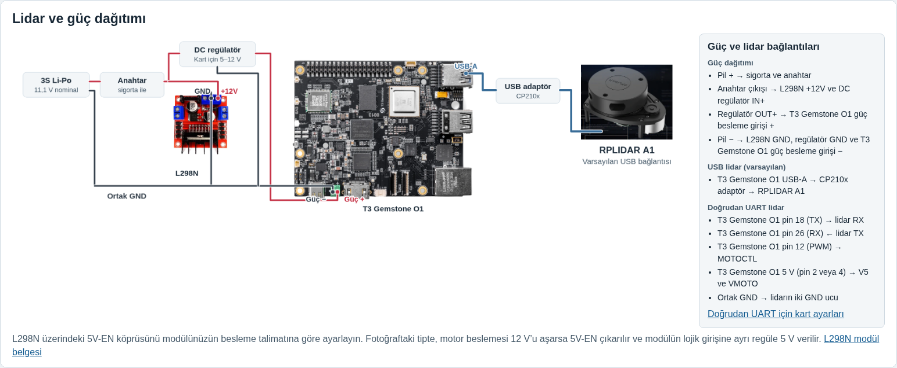
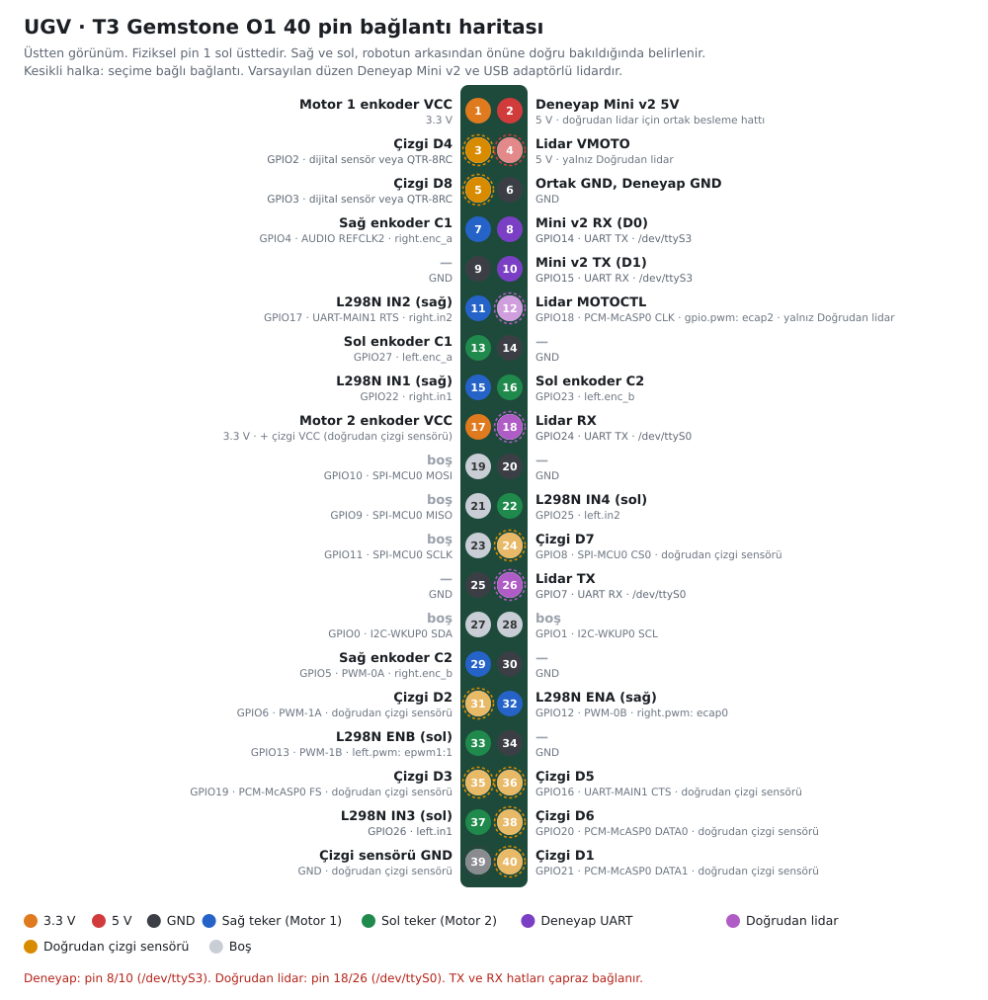

Robotun tüm donanım bağlantıları yazılımda tek bir dosyada tanımlıdır:
[`src/ugv_bringup/config/hardware.yaml`](https://github.com/t3gemstone/ugv-ros/blob/main/src/ugv_bringup/config/hardware.yaml).
Pinler T3 Gemstone O1 hat adlarıyla (`"GPIO22"`), PWM kanalları ise modül adlarıyla (`"ecap0"`) yazılır; yazılım bunları
karttaki hatlara kendisi çözer.

<Warning>
Kabloları değiştirmeden önce pili ve tüm güç kaynaklarını mutlaka ayırın. Pil takılıyken pin değiştirmek GPIO'lara
zarar verebilir. Bağlantılara başlamadan önce [Pil ve Kullanım Güvenliği](/tr/projects/ugv-ros/safety) sayfasını
okuyun.
</Warning>

## 1. Bileşenler

| Bileşen | Bağlantı | Yazılım paketi |
| --- | --- | --- |
| T3 Gemstone O1 | — | Ubuntu 24.04 + ROS 2 Jazzy |
| L298N + 2 × Waveshare DCGM-3865 (12 V, 1:42, 240 rpm) | IN1–IN4 (GPIO), ENA/ENB (PWM) | `ugv_base` |
| Motor enkoderleri (hall, AB, çıkış milinde 546 PPR, dahili pull-up) | 4 × GPIO | `ugv_base` |
| ICM-20948 IMU | Kart üzerinde, SPI `/dev/spidev0.3` | `ugv_imu` |
| RPLIDAR A1 | USB adaptör (varsayılan) **veya** UART `/dev/ttyS0` (pin 18/26) + motor PWM | `sllidar_ros2`, `ugv_hal` |
| Pololu QTR-8A 8 kanallı çizgi sensörü (analog çıkış) | Deneyap Mini v2 ADC → UART `/dev/ttyS3` (varsayılan) **veya** 8 × GPIO | `ugv_line` |
| 3S Li-Po (11,1 V, 4200 mAh, 40C) | L298N beslemesi; T3 Gemstone O1 güç besleme girişine regüle DC besleme. Tüm GND uçları ortak. | — |

## 2. Kablolama Şeması

Sinyal bağlantıları `hardware.yaml` yapılandırmasını gösterir.

### 2.1. Motorlar ve enkoderler

<Frame>
  
</Frame>

### 2.2. Deneyap Mini v2 ve çizgi sensörü

<Frame>
  
</Frame>

### 2.3. Lidar ve güç dağıtımı

<Frame>
  
</Frame>

## 3. 40 Pinli Konnektör

Tablodaki pin numaraları kart üzerindeki fiziksel numaralardır.

<Frame caption="UGV için T3 Gemstone O1 40 pin bağlantı haritası">
  
</Frame>

**Sol/sağ** yönleri, robotun arkasından çizgi sensörünün bulunduğu öne doğru bakılarak belirlenir. Şemadaki Motor 1
(L298N OUT1/OUT2) robotun **sağ**, Motor 2 (OUT3/OUT4) **sol** tekeridir; `hardware.yaml`'daki `left` / `right`
blokları buna göre yazılmıştır. Motorlar başka tarafa takılırsa kablolar değil, `left` ve `right` blokları (yön
ayarlarıyla birlikte) yer değiştirir. Bunu doğrulamak için [Saha Testi](/tr/projects/ugv-ros/field-test#3-motor-yönleri)
sırasında `hw_check motors` önce `left` tekerini döndürür.

| Pin | Sinyal | Bağlantı | `hardware.yaml` |
| --- | --- | --- | --- |
| 1 | 3V3 | Motor 1 enkoder VCC | — |
| 2, 4 | 5V | Deneyap Mini v2 5V (şemada pin 2). GPIO lidar için V5 ve VMOTO aynı 5 V hattını kullanır. | — |
| 3 | GPIO2 | Çizgi D4 (yalnızca `type: digital`, i2c1 overlay'i kapalıyken) | `pins[3]` |
| 5 | GPIO3 | Çizgi D8 (yalnızca `type: digital`, i2c1 overlay'i kapalıyken) | `pins[7]` |
| 6 | GND | Ortak GND, Deneyap GND | — |
| 7 | GPIO4 | Motor 1 (sağ teker) enkoder C1 | `right.enc_a` |
| 8 | GPIO14 (UART-MAIN1 TX) | Deneyap RX | `line_sensor_node.serial.port` |
| 9 | GND | Motor 1 enkoder GND | — |
| 10 | GPIO15 (UART-MAIN1 RX) | Deneyap TX | `line_sensor_node.serial.port` |
| 11 | GPIO17 | L298N IN2 (sağ teker) | `right.in2` |
| 12 | GPIO18 (ecap2) | Lidar MOTOCTL (yalnızca GPIO lidar) | `lidar_manager_node.gpio.pwm: ecap2` |
| 13 | GPIO27 | Motor 2 (sol teker) enkoder C1 | `left.enc_a` |
| 14 | GND | Motor 2 enkoder GND | — |
| 15 | GPIO22 | L298N IN1 (sağ teker) | `right.in1` |
| 16 | GPIO23 | Motor 2 (sol teker) enkoder C2 | `left.enc_b` |
| 17 | 3V3 | Motor 2 enkoder VCC, çizgi sensörü VCC (yalnızca `type: digital`) | — |
| 18 | GPIO24 (UART-WKUP0 TX) | Lidar RX (yalnızca GPIO lidar) | `lidar_manager_node.gpio.port` |
| 22 | GPIO25 | L298N IN4 (sol teker) | `left.in2` |
| 24 | GPIO8 | Çizgi D7 (yalnızca `type: digital`) | `pins[6]` |
| 26 | GPIO7 (UART-WKUP0 RX) | Lidar TX (yalnızca GPIO lidar) | `lidar_manager_node.gpio.port` |
| 29 | GPIO5 | Motor 1 (sağ teker) enkoder C2 | `right.enc_b` |
| 31 | GPIO6 | Çizgi D2 (yalnızca `type: digital`) | `pins[1]` |
| 32 | GPIO12 (ecap0) | L298N ENA (sağ teker) | `right.pwm: ecap0` |
| 33 | GPIO13 (epwm1 B) | L298N ENB (sol teker) | `left.pwm: epwm1:1` |
| 35 | GPIO19 | Çizgi D3 (yalnızca `type: digital`) | `pins[2]` |
| 36 | GPIO16 | Çizgi D5 (yalnızca `type: digital`) | `pins[4]` |
| 37 | GPIO26 | L298N IN3 (sol teker) | `left.in1` |
| 38 | GPIO20 | Çizgi D6 (yalnızca `type: digital`) | `pins[5]` |
| 39 | GND | Çizgi sensörü GND (yalnızca `type: digital`) | — |
| 40 | GPIO21 | Çizgi D1 (yalnızca `type: digital`) | `line_sensor_node.pins[0]` |

## 4. Lidar Bağlantısı

RPLIDAR A1 iki şekilde bağlanabilir. Bağlantı türü web arayüzündeki **Lidar** panelinden seçilir ve seçim robotta
(`~/.ugv/lidar_source`) saklanır. Varsayılan bağlantı USB'dir.

<Tabs>
  <Tab title="USB (varsayılan)">
    Lidarı kendi adaptör kartıyla T3 Gemstone O1'in USB portuna takın; başka kablo gerekmez. Port `/dev/serial/by-id/`
    altında kendiliğinden bulunur ve lidar motorunu adaptör sürer.

    Minimal T3 Gemstone O1 imajında CP210x USB-seri sürücüsü eksik olabilir. `lsusb` adaptörü gösterdiği hâlde
    `/dev/ttyUSB0` oluşmuyorsa [Kurulum](/tr/projects/ugv-ros/installation#2-4-usb-lidar-sürücüsünü-cp210x-kurun)
    sayfasındaki sürücü kurulum adımlarını uygulayın.
  </Tab>
  <Tab title="GPIO (UART)">
    Adaptör kullanılmadan lidarın 7 pinli kablosu doğrudan 40 pinli konnektördeki ikinci UART'a (UART-WKUP0,
    `/dev/ttyS0`) bağlanır. Pin 8/10'daki UART, Deneyap Mini v2 tarafından kullanılır.

    | Lidar | T3 Gemstone O1 |
    | --- | --- |
    | V5, VMOTO | T3 Gemstone O1 5 V hattı (pin 2 ve 4). Mini v2 ile aynı besleme hattını kullanıyorsanız uygun bir dağıtım bağlantısı yapın. |
    | GND (iki uç) | Herhangi bir GND pini |
    | TX | Pin 26 (GPIO7, UART-WKUP0 RX) |
    | RX | Pin 18 (GPIO24, UART-WKUP0 TX) |
    | MOTOCTL | Pin 12 (GPIO18, `ecap2` PWM) |

    Bu bağlantı için `ugv-bt-off`, `uart-ttys0` ve `ecap2` overlay'leri etkin olmalı ve `spidev0-2cs` yerine
    `spidev0-1cs` seçilmelidir. Ayrıntılar için [Kurulum](/tr/projects/ugv-ros/installation#4-pwm-ve-uart-ayarları-overlay)
    sayfasındaki **GPIO lidar** sekmesine bakınız. Lidar motorunun PWM sinyali yalnızca GPIO bağlantısı seçiliyken
    sürülür.

    <Tip>
    Pin 18 ile 26'yı bir jumper ile birleştirip `/dev/ttyS0`'a yazılan verinin geri okunması (geri döngü testi),
    UART yolunun sağlam olduğunu doğrular.
    </Tip>
  </Tab>
</Tabs>

## 5. Çizgi Sensörü

Kitteki sensör, 8 kanallı bir yansıma sensörü dizisi olan **Pololu QTR-8A**'dır. Her kanal VCC'ye çekilmiş bir
fototransistördür: yansıma arttıkça çıkış gerilimi düşer, siyah çizgide çıkış yaklaşık VCC olur. Kartta karşılaştırıcı
yoktur, çıkışlar analogdur. Sensör zemine **3–6 mm** mesafede olmalıdır.

<Warning>
Sensörü **asla 5 V ile beslemeyin** ve kartın üzerindeki **"3.3V" pedini lehimleyin**. Köprü açıkken LED'ler 3,3 V'ta
çok zayıf yanar.
</Warning>

<Note>
Sensörün yüksekliği ölçümü doğrudan etkiler. 1 cm yükseklikte beyaz zeminde 2,7–3,0 V, siyahta 3,1 V ölçülmüştür;
bu yükseklikte fark 100 mV'a kadar düşer ve doğrudan GPIO bağlantısında her kanal 1 okunur. Sensörü zemine 3–6 mm
mesafeye indirin.
</Note>

Sensör iki şekilde bağlanabilir; bağlantı türü `hardware.yaml` → `line_sensor_node.type` ile seçilir.

<Tabs>
  <Tab title="Deneyap Mini v2 (varsayılan)">
    `type: serial` yapılandırmasında Mini v2 sekiz analog kanalı milivolt cinsinden okur ve T3 Gemstone O1'in `/dev/ttyS3`
    UART hattına 115200 baud ile saniyede yaklaşık 50 ölçüm gönderir. Her iki kartın UART hatları 3,3 V lojik seviyesi
    kullanır.

    **Sensör → Mini v2**

    | Sensör | Mini v2 |
    | --- | --- |
    | D1 | A0 |
    | D2 | A1 |
    | D3 | A2 |
    | D4 | A3 |
    | D5 | A4 |
    | D6 | A5 |
    | D7 | A6 |
    | D8 | A7 |
    | VCC ve IR | 3V3 |
    | GND | GND |

    **Mini v2 → T3 Gemstone O1**

    | Mini v2 | T3 Gemstone O1 |
    | --- | --- |
    | TX / D1 (GPIO43) | Pin 10 (GPIO15, UART RX) |
    | RX / D0 (GPIO44) | Pin 8 (GPIO14, UART TX) |
    | GND | Pin 6 (GND) |
    | 5V | T3 Gemstone O1 5 V (şemada pin 2) |

    - Sensörün **D1–D8** çıkışları Mini v2'nin **A0–A7** girişlerine gider. Mini v2'nin D1 pini burada sensör girişi
      değil, T3 Gemstone O1'e giden UART TX pinidir.
    - Sinyal bağlantısında TX ile RX'i çaprazlayın ve GND uçlarını birleştirin.
    - Mini v2'nin 5V pini USB besleme hattına bağlıdır. Programlamak için Mini v2'yi bilgisayara USB ile bağlamadan
      önce T3 Gemstone O1'den gelen 5 V hattını ayırın.
      [Deneyap Mini v2 pin tanımları](https://docs.deneyapkart.org/tr/Cards/Deneyap-Mini-v2/Pin-Definitions-dymv2)

    T3 Gemstone O1'de `hardware.yaml` içinde `type: serial`, `serial.port: /dev/ttyS3` ve `serial.baudrate: 115200`
    olmalıdır. Mini v2'ye yüklenecek yazılım için [Kurulum](/tr/projects/ugv-ros/installation#3-deneyap-mini-v2-yazılımının-yüklenmesi)
    sayfasına bakınız. Aynı kaynak kod Deneyap Kart 1A v2 için de derlenebilir; bu durumda o kartın pin etiketlerini
    izleyin.
  </Tab>
  <Tab title="Doğrudan GPIO">
    `type: digital` yapılandırmasında Deneyap kullanılmadan sensör çıkışları T3 Gemstone O1 GPIO'larıyla eşiklenir
    (siyah = 1). Beyaz zeminde çıkışın 0,8 V'un altına inmesi gerekir; bu yalnızca sensör zemine yakın ve LED'ler
    parlakken mümkündür.

    | Sensör | T3 Gemstone O1 |
    | --- | --- |
    | VCC | Pin 17 (**3,3 V**) |
    | GND | Pin 39 |
    | IR | Boşta (LED'ler açık) |
    | D1 … D8 | Pin 40, 31, 35, 3, 36, 38, 24, 5 |

    - 5 V verilirse çıkışlar VCC'ye çekili olduğu için T3 Gemstone O1 pinlerine zarar verir.
    - D1–D8 kabloları takılı değilken girişler boşta kalır ve 1 okuyabilir; T3 Gemstone O1 pad'lerinde dahili
      pull-up/pull-down yazılımdan açılamaz. Tüm kanallar sürekli 1 okunuyorsa önce VCC/GND ve D kablolarını kontrol
      edin.
    - D4/D8 için kullanılan GPIO2/GPIO3 (pin 3/5) I2C1 hattıdır. Bu bağlantıyı kullanacaksanız `/boot/uEnv.txt`
      dosyasından `i2c1-400000` overlay'ini çıkarın (robotta I2C1'e bağlı cihaz yoktur). D7 için kullanılan GPIO8
      (pin 24) SPI0 seçim pinidir; IMU kart içinde ayrı bir seçim hattı kullanır.
    - Pin 12, 18 ve 26 GPIO lidara, pin 37 L298N IN3'e ayrılmıştır; çizgi sensörüne verilmez.
  </Tab>
</Tabs>

Sensörün kalibrasyonu robot çalışırken web arayüzünden yapılır.
[Çizgi sensörü kalibrasyonu](/tr/projects/ugv-ros/usage#3-çizgi-sensörü-kalibrasyonu)

## 6. Elektriksel Uyarılar

- **T3 Gemstone O1 GPIO'ları 3,3 V'tur.** Enkoderler şemada 3V3'ten beslenir; dahili pull-up'ları da 3,3 V'a çeker.
  Enkoderleri 5 V'tan beslemeyin.
- **Çizgi sensörünü yalnızca 3,3 V ile besleyin** ve "3.3V" köprüsünü lehimleyin. IR ucu boş kalabilir.
- Lidar 5 V ile beslenir ancak UART sinyalleri 3,3 V'tur ve doğrudan bağlanabilir. Lidar TX → T3 Gemstone O1 RX (pin 26),
  lidar RX → T3 Gemstone O1 TX (pin 18).
- L298N üzerindeki ENA/ENB jumper'ları **çıkarılmış** olmalıdır.
- L298N üzerindeki 5V-EN köprüsünü modülün besleme talimatına göre ayarlayın. Motor beslemesi 12 V'u aşarsa 5V-EN
  köprüsü çıkarılmalı ve modülün lojik girişine ayrı bir 5 V verilmelidir.
- 3S pil dolu iken 12,6 V'tur; L298N yaklaşık 2 V düşürdüğü için motorlar anma geriliminin biraz altında çalışır.
  `max_wheel_speed` değerini [Saha Testi](/tr/projects/ugv-ros/field-test#5-hız-aralığı) sırasında `hw_check sweep`
  ile ölçün.
- Batarya, L298N, T3 Gemstone O1 ve enkoder GND'leri ortak olmalıdır.
- T3 Gemstone O1'in güç besleme girişini 5–12 V aralığında besleyin. Tam dolu 3S pil 12,6 V'a ulaştığı için
  güç besleme girişine uygun bir DC regülatör üzerinden girin.
  [Pil ve Kullanım Güvenliği](/tr/projects/ugv-ros/safety)
