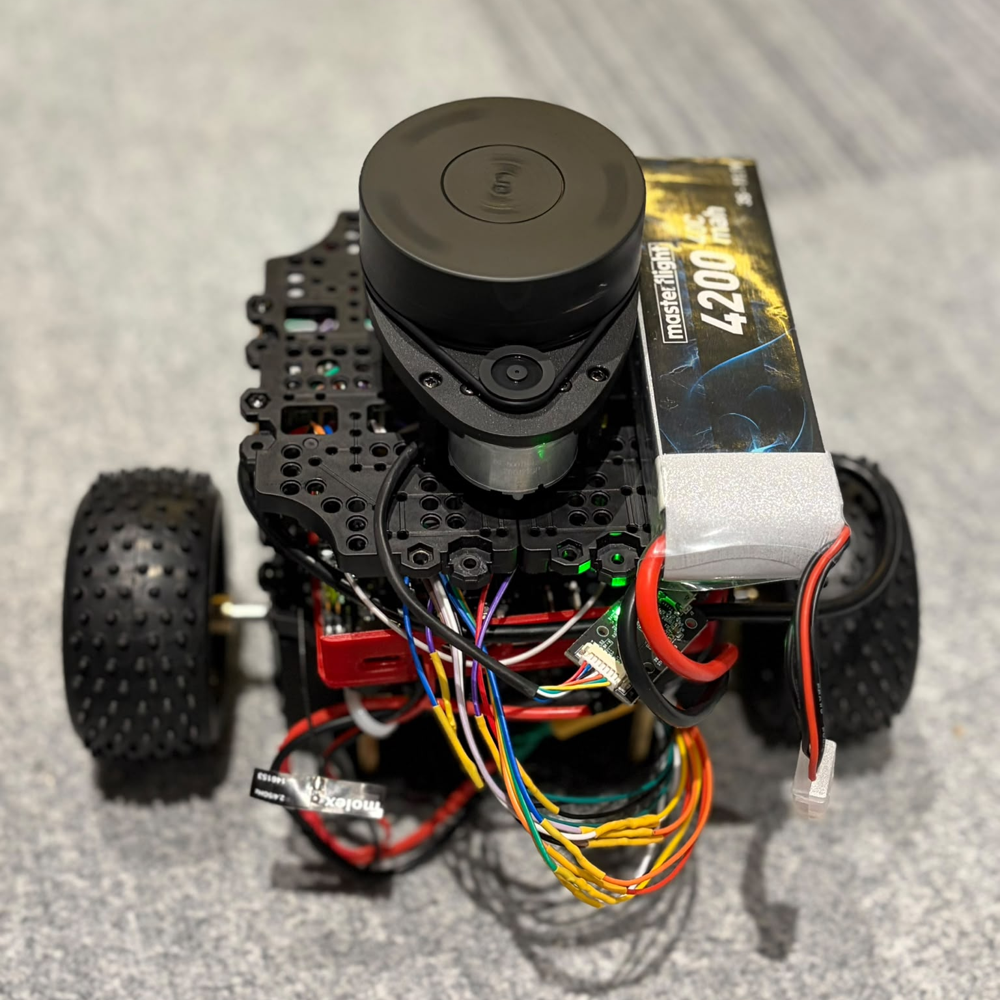
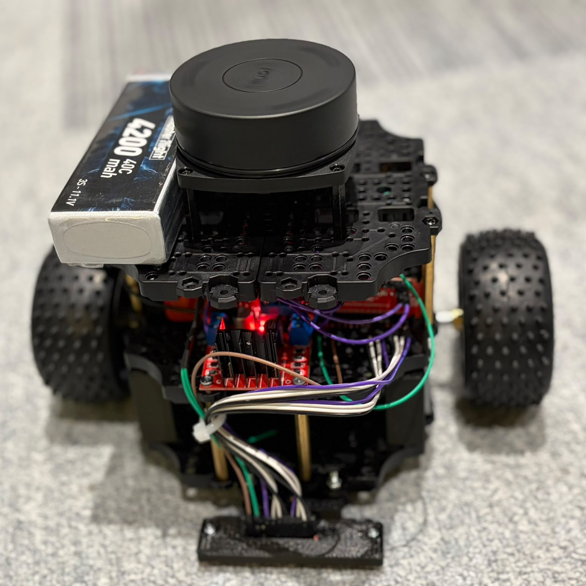
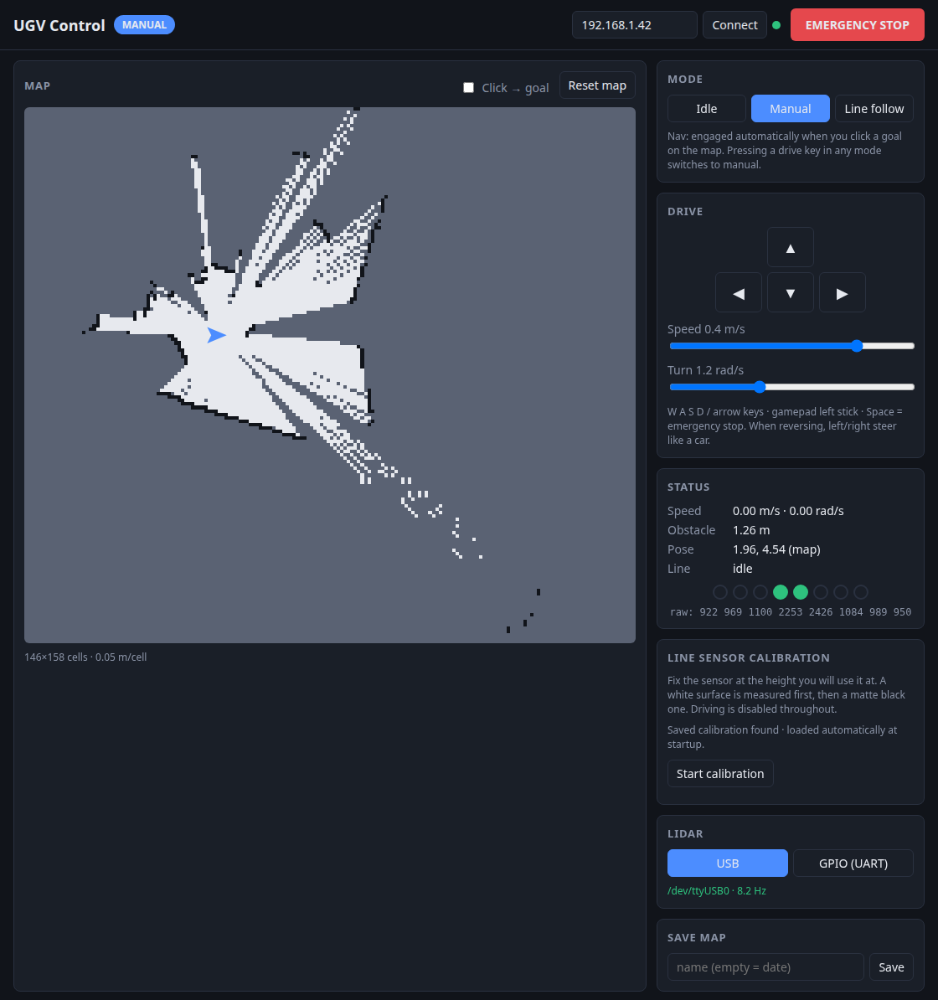

<Columns cols={2}>
  <Frame caption="Pil ve kablo yerleşimi">
    
  </Frame>
  <Frame caption="Çizgi sensörü ve motor sürücüsü">
    
  </Frame>
</Columns>

<Tip>
Bölüm bitiminde aşağıdaki konularda bilgi sahibi olacaksınız.

* T3 Gemstone O1 üzerinde **Ubuntu 24.04** ve **ROS 2 Jazzy** ile bir kara robotunun kurulması
* Motor, enkoder, IMU, çizgi sensörü ve lidar bağlantılarının yapılması
* Robotun web arayüzünden sürülmesi, çizgi izlemesi ve lidar ile harita çıkarması
* Kayıtlı harita üzerinde Nav2 ile hedefe otonom gidilmesi
</Tip>

## 1. Giriş

UGV ROS, T3 Gemstone O1 tabanlı, diferansiyel sürüşlü bir kara robotudur. Robot üzerinde **Ubuntu 24.04 ve ROS 2 Jazzy**
çalışır. Robot çizgi izleyebilir, lidar ile çevresinin haritasını çıkarabilir ve Nav2 etkinleştirildiğinde kayıtlı harita
üzerinde belirlenen bir hedefe gidebilir.

- **Manuel sürüş** için klavye, ekrandaki yön tuşları veya gamepad kullanılır. Tekerlek hızı enkoderlerle ölçülür,
  odometri kart üzerindeki IMU ile birleştirilir.
- **Çizgi izleme** için sekiz kanallı analog sensör Deneyap Mini v2 üzerinden okunur. Beyaz ve siyah zemin ölçümleri web
  arayüzünden kaydedilir.
- **Haritalama ve navigasyon** için RPLIDAR A1 kullanılır. Harita kaydedilebilir ve Nav2 etkinleştirildiğinde harita
  üzerinden hedef verilebilir.

Projenin kaynak kodlarına [t3gemstone/ugv-ros](https://github.com/t3gemstone/ugv-ros) deposundan erişebilirsiniz.

## 2. Bileşenler

| Bileşen | Görev |
| --- | --- |
| **T3 Gemstone O1** | Ana bilgisayar. ROS 2 düğümleri, web arayüzü, kart üzerindeki ICM-20948 IMU |
| **L298N** motor sürücüsü | İki motorun yönünü ve hızını (PWM) sürer |
| 2 × **Waveshare DCGM-3865** | 12 V, 1:42 redüktörlü, 240 rpm, hall enkoderli DC motorlar |
| **Deneyap Mini v2** | Çizgi sensörünün sekiz analog kanalını okuyup UART ile T3 Gemstone O1'e gönderir |
| Pololu QTR-8A çizgi sensörü | 8 kanallı analog, siyah/beyaz zemin algılama |
| **RPLIDAR A1** | 360° lidar; haritalama, konumlandırma ve engel algılama |
| 3S Li-Po (11,1 V, 4200 mAh) | Motor ve kart beslemesi |

Pin bağlantılarının tamamı [Donanım ve Kablolama](/tr/projects/ugv-ros/hardware) sayfasında yer almaktadır.

## 3. Web Arayüzü

Robot üzerinde çalışan **UGV Control** arayüzüne aynı ağa bağlı bir bilgisayarın tarayıcısından erişilir. Bilgisayarda
ROS kurulu olması gerekmez.

<Frame caption="UGV Control ekranı, kayıtlı bir lidar taramasından aktarılan harita ve örnek sensör değerleriyle.">
  
</Frame>

| Panel | İşlev |
| --- | --- |
| **Mode** ve **Drive** | **Idle**, **Manual** veya **Line follow** modunu seçin. Manuel sürüşte ekran tuşlarını, WASD veya ok tuşlarını ya da gamepad'i kullanın. Hızı ve dönüş hızını ayarlayın. |
| **Map** | SLAM ile oluşan haritayı ve robotun konumunu izleyin. **Save map** paneliyle haritayı kaydedin. Nav2 açıkken **Click → goal** seçeneğiyle harita üzerinden hedef verin. |
| **Status** ve **Line sensor calibration** | Hızı, engel mesafesini ve çizgi sensörü ölçümlerini izleyin. Deneyap seri sensörünü beyaz ve siyah yüzeylerle kalibre edin. |
| **Lidar** | Kablolamaya göre **USB** veya **GPIO (UART)** seçin ve tarama hızını kontrol edin. |

Sürüşü durdurmak için **EMERGENCY STOP** düğmesini veya **Boşluk** tuşunu kullanın.

## 4. İlk Kullanım Adımları

<Steps>
  <Step title="İşletim sistemini ve UGV yazılımını kurun">
    T3 Gemstone O1'e Ubuntu 24.04 imajını yazın, ROS 2 Jazzy'yi ve bağımlılıkları kurup çalışma alanını derleyin.
    Ardından Deneyap Mini v2'ye çizgi sensörü yazılımını yükleyin ve PWM/UART overlay'lerini etkinleştirin.
    [Kurulum](/tr/projects/ugv-ros/installation)
  </Step>
  <Step title="Donanımı bağlayın">
    Güç kapalıyken motor, enkoder, çizgi sensörü ve lidar bağlantılarını tamamlayın.
    [Donanım ve Kablolama](/tr/projects/ugv-ros/hardware)
  </Step>
  <Step title="Güvenlik kurallarını okuyun">
    İlk sürüşten önce pil ve kullanım güvenliği kurallarını okuyun.
    [Pil ve Kullanım Güvenliği](/tr/projects/ugv-ros/safety)
  </Step>
  <Step title="Saha testini yapın">
    Tekerlekleri yerden kaldırarak motor yönlerini, enkoderleri, IMU'yu ve lidarı adım adım doğrulayın.
    [Saha Testi](/tr/projects/ugv-ros/field-test)
  </Step>
  <Step title="Robotu başlatın ve kullanın">
    Robotu başlatın, web arayüzünü açın, çizgi sensörünü kalibre edin ve harita çıkarın.
    [Kullanım](/tr/projects/ugv-ros/usage)
  </Step>
</Steps>

## 5. Teknik Referanslar

<CardGroup cols={2}>
  <Card title="Mimari" icon="sitemap" href="/tr/projects/ugv-ros/architecture">
    ROS 2 paketleri, konular, servisler ve sürüş modları
  </Card>
  <Card title="Simülasyon" icon="cube" href="/tr/projects/ugv-ros/simulation">
    Robot olmadan Gazebo'da haritalama, navigasyon ve çizgi izleme
  </Card>
  <Card title="Ağ Bağlantısı" icon="wifi" href="/tr/projects/ugv-ros/network">
    Robotu yeni bir Wi-Fi ağına bağlama ve IP adresini bulma
  </Card>
  <Card title="PWM" icon="wave-square" href="/tr/boards/o1/peripherals/pwm">
    T3 Gemstone O1 PWM kanalları ve overlay yapılandırması
  </Card>
  <Card title="IMU" icon="compass" href="/tr/boards/o1/peripherals/imu">
    Kart üzerindeki ICM-20948 sensörü
  </Card>
</CardGroup>
