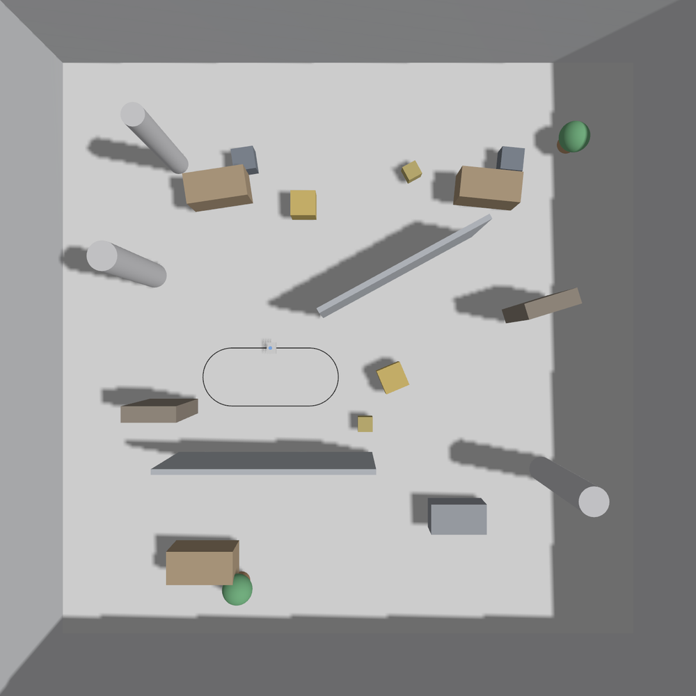
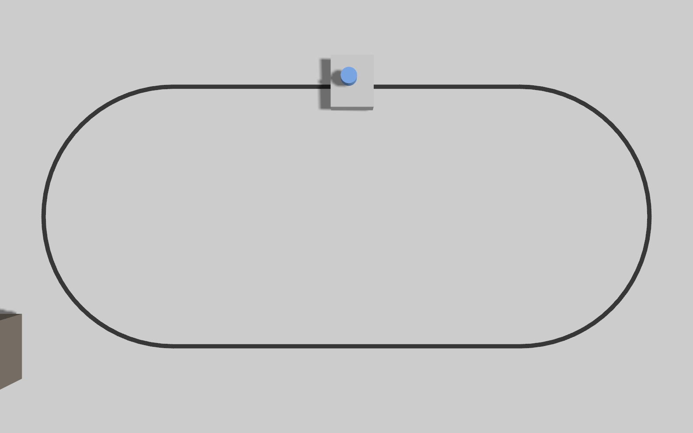

`ugv_simulation` paketi robotu geliştirme bilgisayarında Gazebo Harmonic ile çalıştırır. Donanımın yerini Gazebo alır:
hız komutlarını Gazebo'nun diferansiyel sürüşü uygular; lidar, IMU ve çizgi sensörü robottaki topic'lerle simüle
edilir. Yazılımın geri kalanı (mod yöneticisi, EKF, slam_toolbox, Nav2, çizgi izleme ve web arayüzü) değişmeden
çalışır; böylece haritalama, navigasyon ve çizgi izleme robot olmadan denenebilir.

<Frame caption="Ofis dünyası yukarıdan. Çizgi pisti solda, robot pistin üzerinde.">
  
</Frame>

## 1. Simülasyonu Başlatma

Simülasyon deponun geliştirme ortamında (Distrobox içinde Ubuntu 24.04 ve ROS 2 Jazzy) çalışır. Gazebo yalnızca bu
ortama kurulur, robota kurulmaz. Geliştirme bilgisayarında, depo dizininde aşağıdaki komutları çalıştırın:

```bash
./setup.sh       # bir kez: Docker ve jetify-devbox'ı kurar
devbox shell     # Distrobox, Task ve vcstool'u kurar
task fetch       # üçüncü parti kaynaklar
task box         # geliştirme ortamını oluşturur ve içine girer
task sim         # geliştirme ortamının içinde
```

Gazebo penceresi ofis dünyasıyla açılır, web arayüzü `http://localhost:8000` adresindedir. Simülasyonu `Ctrl+C` ile
durdurun.

<Note>
`task build`, `task sim` ve diğer ROS görevleri, istemi 🚀 ile başlayan geliştirme ortamının içinde çalışır.
Bilgisayarın kendisinde çalıştırılırsa önce `task box` istendiğini söyleyen bir mesajla dururlar.
</Note>

### 1.1. Argümanlar

Argümanlar `--` işaretinden sonra eklenir, örneğin `task sim -- nav:=true gui:=false`.

| Argüman | Değerler | Açıklama |
| --- | --- | --- |
| `gui` | `true` \| `false` | Gazebo penceresi; `false` yalnızca simülasyonu ekransız çalıştırır |
| `nav` | `true` \| `false` | Nav2 (varsayılan olarak kapalı) |
| `line` | `true` \| `false` | Simüle çizgi sensörü ve çizgi izleme |
| `x`, `y`, `yaw` | m, m, rad | Başlangıç pozu; varsayılan olarak çizgi pistinin üzerinde, (-1,6, 0) noktasında, pist yönünde |
| `world` | `<sdf>` | Dünya dosyası; varsayılan olarak ofis dünyası |
| `fusion`, `slam`, `slam_mode`, `map`, `gcs` | | Robottaki gibi; bkz. [Başlatma argümanları](/tr/projects/ugv-ros/usage#1-1-başlatma-argümanları) |

## 2. Simülasyonu Kullanma

### 2.1. Haritalama

Web arayüzünde **Manual** moda geçin ve robotu klavye, ekrandaki tuşlar ya da gamepad ile sürün. Harita robot ilerledikçe
büyür. slam_toolbox yeni bir taramayı ancak robot yaklaşık 0,15 m yer değiştirdikten sonra ekler; bu yüzden robot yerinde
dönerken harita büyümez. **Save map** paneliyle kaydedilen haritalar, geliştirme ortamının ev dizini olan depodaki
`.distrobox/ugv_maps` klasörüne yazılır.

### 2.2. Çizgi izleme

Robot, 1,6 m'lik iki düz kenarı ve 0,6 m yarıçaplı iki dönüşü olan siyah bir çizgi pistinin üzerinde başlar.
**Line follow** modunu seçtiğinizde robot pisti, robottakiyle aynı denetleyici ve parametrelerle (`control.yaml`) izler.
Web arayüzündeki çizgi sensörü göstergesi sekiz kanalı gösterir.

<Frame caption="Çizgi pisti ve başlangıç pozundaki robot.">
  
</Frame>

### 2.3. Navigasyon

Simülasyonu `task sim -- nav:=true` ile başlatın. **Manual** modda bir harita çıkardıktan sonra **Click → goal**
seçeneğini açıp haritada bir noktaya tıklayın; robot yolu planlayıp oraya gider.

## 3. Neler Simüle Edilir

| Robotta | Simülasyonda | Topic'ler |
| --- | --- | --- |
| Motorlar ve enkoderler (`ugv_base_node`) | Gazebo diferansiyel sürüşü | `/cmd_vel` → `/wheel/odom`, `/joint_states` |
| ICM-20948 IMU (`ugv_imu_node`) | Gerçeği gibi takılı Gazebo IMU'su | `/imu/data_raw` |
| RPLIDAR A1 (`sllidar_ros2`) | Gazebo lidarı: 360 ölçüm, 0,15–12 m, 8 Hz | `/scan` |
| Pololu QTR-8A çizgi sensörü (`line_sensor_node`) | Sensör dizisinin yerinde aşağı bakan bir kamera; `line_sensor_sim` görüntüsünü sekiz kanala çevirir | `/line/state` |

Robot modeli `ugv_description` paketinden gelir; `config/robot.yaml` dosyasındaki değişiklikler simülasyona da yansır.
Kütleler tahminidir. Web arayüzündeki çizgi sensörü kalibrasyonu ve lidar bağlantısı panelleri ile `hw_check` ve
`line_check` araçları donanım gerektirir, simülasyonda çalışmaz.

## 4. Sorun Giderme

<AccordionGroup>
  <Accordion title="task sim neden önce task box istiyor?">
    Komut bilgisayarın kendisinde çalıştırılmıştır. ROS 2 ve Gazebo yalnızca geliştirme ortamında bulunur: ortama
    `task box` ile girin ve `task sim` komutunu orada, 🚀 ile başlayan istemde çalıştırın.
  </Accordion>
  <Accordion title="Web arayüzü http://localhost:8000 adresinde neden açılmıyor?">
    8000 portunu başka bir program kullandığı için simülasyon web sunucusunu başlatamamıştır. O programı durdurup
    `task sim` komutunu yeniden çalıştırın.
  </Accordion>
  <Accordion title="Harita neden büyümüyor?">
    slam_toolbox yeni bir taramayı ancak robot yaklaşık 0,15 m yer değiştirdikten sonra ekler; bu yüzden robot yerinde
    dönerken harita büyümez. Robotu ileri sürün.
  </Accordion>
</AccordionGroup>
